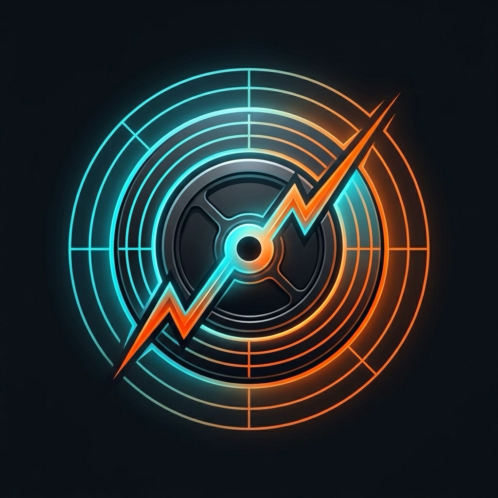

# ⚡️ Hybrid Athlete Training (混合體能自適應排課系統)

<p align="center">
  
</p>

<p align="center">
  <b>專為同時進行「耐力路跑」與「重訓力量」的混合體能運動員打造的 iPhone 原生自適應排課引擎</b><br/>
  iOS 17.0+ · Apple Watch · WorkoutKit · HealthKit · SwiftData · Clean Architecture · 100% Local-First
</p>

---

## 🎯 產品核心願景 (Product Vision)

在傳統穿戴設備中，跑者的有氧負荷（Garmin / Strava）與重訓愛好者的神經疲勞（Hevy / Strong）往往是相互割裂的。
**HybridTraining** 專為解決運動科學中的「雙向衝突與殘餘疲勞管理 (Bidirectional Residual Fatigue Management)」而設計：
- 當下肢經歷高強度深蹲/硬舉破壞時，自動熔斷高衝擊跑步（限制為 Zone 2 或切換至新鮮的上半身推/拉）。
- 根據夜間 Apple Watch 實測的 **HRV SDNN 穩健 Z 分數 (Robust Z-score)** 與睡眠去重時長，動態升降級今日課表強度。
- 支援一鍵推播結構化間歇/配速課表至 **Apple Watch 原生「體能訓練」App**。
- **100% Local-First 零上傳隱私**：所有生理數據皆保留於本機端，無任何第三方伺服器依賴。

---

## 🚀 Version 2.0 核心亮點 (Key Features)

| 模組 | 功能說明 |
| :--- | :--- |
| **今日命令中心 (Dashboard)** | 實時展示當日自律神經準備度評分 (Readiness)、第一主推薦課表、運動學互補換課備選、4 大動作模式冷卻時鐘。 |
| **Apple Watch 原生閉環 (WorkoutKit)** | 一鍵將目標配速、心率區間、暖身/間歇步驟排程進 Apple Watch 內建體能訓練 App。 |
| **生理與負荷趨勢 (Analytics & Charts)** | 運用 Apple 原生 **Swift Charts** 繪製 14 天滾動夜間 HRV 走勢帶、急慢性運動負荷比 (ACWR 甜蜜區間 0.80～1.30)、夜間睡眠去重趨勢。 |
| **訓練歷史日誌 (Logbook)** | 整合 HealthKit 跑步資料與本地 15 秒肌力打卡紀錄，提供智慧對帳與單一事實入帳。 |
| **運動員偏好設定 (Athlete Profile)** | 可自訂靜息心率 (RHR)、最大心率 (Max HR)、下肢深蹲與硬舉個人化冷卻時長 (24h～72h)。 |

---

## 📐 底層運動科學與決策數學 (Scientific Foundations)

### 1. 統一運動負荷貨幣 (Session Load AU)
$$\text{Session Load (AU)} = \text{Duration (min)} \times \text{sRPE (1.0 ～ 10.0)}$$
- **跑步**：由心率區間（Zone 0～5）停留時間自動推算等效 sRPE，並過濾傳感器雜訊（離散箝位 $\le 15\text{s}$）。
- **肌力**：極簡 15 秒打卡滑桿輸入。

### 2. 自律神經準備度模型 (Robust Z-Score)
為防止單日極端離群值扭曲基線，採用 14 天夜間 HRV 之**中位數 (Median)** 與**絕對離差中位數 (MAD)**：
$$\text{Robust Z-Score} = \frac{\text{HRV}_{\text{today}} - \text{Median}_{14d}}{1.4826 \times \max(\text{MAD}_{14d}, 2.0)}$$
- 若夜間未佩戴手錶，自動觸發**低信心度平滑降級**，將睡眠時長權重由 0.35 放大至 0.70。

### 3. 急慢性負荷比 (ACWR-SMA)
$$\text{ATL}_7 = \frac{1}{7} \sum_{t=0}^6 \text{Load}_{d-t}, \quad \text{CTL}_{28} = \max\left( \frac{1}{28} \sum_{t=0}^{27} \text{Load}_{d-t}, \; 30.0 \right)$$
- 引入 $\text{CTL} \ge 30.0$ 保底機制，杜絕中斷後冷啟動暴衝。
- ACWR 介於 $0.80 \sim 1.30$ 屬於適應甜蜜區；超過 $1.50$ 自動提示減量。

### 4. 4 大動作模式雙向冷卻狀態機 (Continuous Cooldown)
$$\text{RemainingHours} = \max(0.0, \; \text{BaseCooldownHours} \times \text{Discount} - \Delta t_{\text{elapsed}})$$
- 當下肢冷卻 $> 24\text{小時}$：限制跑步衝擊，主推薦自動切換至「上半身推 (Push)」或「上半身拉 (Pull)」。

---

## 🏛 架構設計 (Clean Architecture)

```
HybridTraining/
├── HybridTrainingEngine/            # 純領域 Swift Package (0 外部依賴)
│   ├── Sources/HybridTrainingCore/  # 數學模型、狀態機、政策引擎、Ports 抽象
│   ├── Sources/HybridTrainingStorage/# SwiftData 本機持久層 (@Model SDWorkoutSession)
│   └── Tests/HybridTrainingCoreTests/# 9 大邊界 BDD 單元測試 (0.013 秒秒級執行)
├── HybridTrainingApp/               # SwiftUI iOS 應用層 (iOS 17.0+)
│   ├── App/                         # App 進入點與 4 Tab 主導覽列
│   ├── Features/
│   │   ├── Dashboard/               # 今日命令中心、Hero Card、冷卻時鐘
│   │   ├── Analytics/               # Swift Charts 趨勢視覺化 (HRV / ACWR / Sleep)
│   │   ├── Logbook/                 # 訓練歷史與核銷日誌
│   │   ├── Settings/                # 運動員參數、法規免責與隱私
│   │   ├── QuickLog/                # 15 秒觸覺滑桿打卡
│   │   └── SpikesAndAudit/          # Gate 1~5 真機生理數據探針
│   ├── Infrastructure/
│   │   ├── HealthKit/               # HealthKitAdapter (HKStore 轉譯)
│   │   └── WorkoutKit/              # WorkoutKitAdapter (Apple Watch 排程)
│   └── Resources/                   # 1024x1024 AppIcon、Entitlements、Info.plist
├── project.yml                      # XcodeGen 確定性工程配置
└── .github/workflows/ci.yml         # GitHub Actions 自動化 CI 測試
```

---

## 🛠 本地開發與實機部署 (Getting Started)

### 環境需求
- macOS Sonoma 或更新版本
- Xcode 15.0+ (支援 iOS 17.0+ SDK)
- [XcodeGen](https://github.com/yonaskolb/XcodeGen) (`brew install xcodegen`)
- （選用）實體 iPhone 15 Pro 或以上 + 配對之 Apple Watch

### 1. 生成 Xcode 專案
```bash
git clone https://github.com/your-username/hybrid-athlete-training.git
cd hybrid-athlete-training

# 透過 XcodeGen 重新生成 .xcodeproj
xcodegen generate
```

### 2. 執行核心單元測試
```bash
cd HybridTrainingEngine
swift test
# 驗證 9/9 測試 100% 通過
```

### 3. 部署至實體 iPhone
1. 在 Xcode 中打開 `HybridTrainingApp.xcodeproj`。
2. 前往 **Signing & Capabilities**，選擇您的個人 Apple ID Team。
3. iPhone 啟用 **設定 ➔ 隱私權與安全性 ➔ 開發者模式** 並重新開機。
4. 連接傳輸線，點擊 Run (`Cmd + R`) 安裝。
5. 首次開啟請允許 Apple HealthKit 讀取權限。

---

## ⚖️ 醫療免責聲明 (Medical Disclaimer)

本軟體並非醫療器材，所有準備度分數、心率區間判定、ACWR 負荷與排課推薦均基於公開之運動科學與人體工學啟發式演算法，僅供健康成年人自主訓練參考。使用者在展開任何高強度訓練前應先諮詢合格醫師或物理治療師。

---

## 📄 授權條款 (License)

本專案基於 [MIT License](LICENSE) 條款開源。
