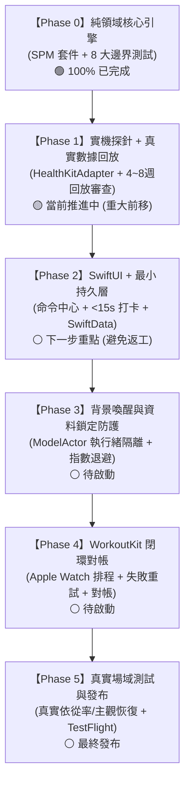

# iPhone 混合訓練自適應排課系統：全階段產品需求與工程實施計畫書 (Master PRD & Phased Roadmap)

> **版本**：v3.1 (方向審查校準版)  
> **更新日期**：2026-10-17  
> **目標設備**：iPhone Only (iOS 17.0+) 搭配 Apple Watch / WorkoutKit 生態  
> **架構基準**：Clean Architecture (純領域引擎 `HybridTrainingCore` + SwiftData 適配 `HybridTrainingStorage`)  
> **當前狀態**：Phase 0 核心演算法 100% 通過 8 項測試，確立啟發式疲勞管理定位與提前真實數據回放機制。

---

## 🧭 一、 產品願景、目標與核心護城河 (Vision & Core Moat)

### 1.1 產品定位 (Product Positioning)
專為 **「混合體能運動員 (Hybrid Athlete，同時進行耐力路跑與重量訓練）」** 打造的 iPhone 原生智慧排課工具。在手機本地端側運行雙軌衝突仲裁狀態機，針對高強度路跑對下肢關節的離心衝擊與大重量深蹲/硬舉造成的 DOMS 與神經疲勞進行動態協調。
* **科學嚴謹定位**：本產品致力於 **「雙向殘餘疲勞與肌纖維微創傷管理 (Bidirectional Residual Fatigue & Micro-trauma Management)」**，而非宣稱消除生理學底層的分子干擾效應（Interference Effect）。所有冷卻參數與風控閾值皆為可配置的「工程啟發式規則 (Configurable Heuristics)」。

### 1.2 核心護城河與競品差異化 (True Moat)
1. **雙向運動學疲勞仲裁**：主流穿戴（Garmin/Apple/WHOOP）雖已具備自覺強度或單項負荷評估，但仍缺乏「跑步衝擊 ⇄ 下肢重訓微創傷」之間的雙向動態互鎖與換課引導。
2. **堅守極低操作摩擦力 (< 15 秒打卡)**：摒棄逐組逐動輸入重量次數的繁瑣流程，僅需點選 4 大動作模式 + 時長 + Foster sRPE 滑桿，保障混合運動員數月以上的真實依從性。
3. **100% Local-First 零上傳隱私承諾**：無雲端帳號綁定、無伺服器等待延遲、資料 100% 保留在本機；冷啟動 < 0.5 秒。
4. **法規與合規免責聲明**：本產品非醫療器材，所有排程建議僅供健康成人自主訓練疲勞管理參考，不具任何醫療診斷或處方效力。

---

## 📐 二、 底層運動科學與決策數學基準 (Settled Mathematical Core)

所有公式皆已於 `HybridTrainingCore` 中落實，並抽象為可配置的 `TrainingConfiguration` 結構體（ADR 0001～0006）：

1. **統一運動負荷貨幣**：
   $$\text{Session Load (AU)} = \text{Duration (min)} \times \text{sRPE (1.0 ～ 10.0)}$$
   * 跑步：由心率區間（Zone 0～5）時間加權推導等效 sRPE，並經個人中位數偏差 $\text{PersonalBias}$ 修正。
   * 肌力：App 15 秒打卡滑桿輸入。
2. **急性與慢性滾動負荷模型 (ACWR-SMA)**：
   $$\text{ATL}_d = \frac{1}{7} \sum_{t=0}^6 \text{Load}_{d-t}, \quad \text{CTL}_d = \max\left( \frac{1}{28} \sum_{t=0}^{27} \text{Load}_{d-t}, \; \text{ctlFloor} \right)$$
   * 採用簡單移動平均（SMA），預設 $\text{ctlFloor} = 30.0\text{ AU/day}$ 保底。
   * 依據 Impellizzeri (2020) 等學者批評，ACWR 存在數學耦合與預測局限，本系統**嚴格將其作為「短期負荷增量提醒」之軟性啟發參考，絕不作為硬性鎖死閘門**。
   * 滿 28 天日曆跨度（含休息日）精準計算，杜絕冷啟動分母扭曲。
3. **自律神經與準備度模型 (Readiness Score)**：
   * 採 14 天夜間 HRV SDNN 之穩健中位數與絕對離差中位數（MAD，保底 2.0ms）計算 Z-Score。
   * **低信心度平滑降級**：當無手錶或夜間 HRV 缺失時，動態將睡眠權重由 0.35 倍增至 0.70，使規律作息者在無手錶時仍能合理取得綠燈課表。
4. **4 大動作模式雙向冷卻狀態機**：
   * 上半身推/拉：12～48h；下肢前側/後側鏈：18～60h（同日次要輔項享 0.7 折減）。
   * 下肢冷卻 $> 24\text{h}$：自動限制跑步為 Zone 2（$\le 40\text{m}$），優先推薦未疲勞之上半身肌力模式；全身冷卻則退避至主動恢復超慢跑或伸展。
5. **資料去重與對帳閉環**：
   * 手錶訓練與 App 打卡時間重疊 $\ge 50\%$ 觸發 **Best-Fit 智慧合併**（單筆入帳，時長採手錶，動作模式採 App）。
   * 跨日延遲補打卡以真實結束時間為錨點，連續浮點小時衰減回推剩餘冷卻。

---

## 🗺️ 三、 全專案五大階段實施路線圖 (5-Phase Implementation Roadmap)

---

### Phase 0：純領域數學與仲裁引擎 (Core Domain Engine)
* **狀態**：`[已完成 (DONE)]`
* **交付成果**：
  * [x] 建立 `HybridTrainingEngine` SPM 套件（拆分 `HybridTrainingCore` 與 `HybridTrainingStorage`）。
  * [x] 實作 `FosterLoadCalculator`（Zone 0~5、離散心率 15s 箝位、50% 覆蓋率防呆）。
  * [x] 實作 `ACWRCalculator`（ATL 7d / CTL 28d，CTL 30.0 保底，休息日跨度修復，支援 `TrainingConfiguration`）。
  * [x] 實作 `RobustZScoreCalculator`（14d MAD Z-score、低信心度動態加權）。
  * [x] 實作 `MuscleCooldownEngine`（雙向衝擊、0.7 輔項折減、連續小時衰減、獨立取最大值）。
  * [x] 實作 `SmartMergeEngine`（Best-Fit 最大重疊率匹配、單一負荷入帳）。
  * [x] 實作 `TrainingPolicyEngine`（確定性時間注入 `now: Date`、傷病熔斷、上半身感知備選）。
  * [x] 8 項單元與 BDD 極端邊界測試 100% 通過（耗時 0.008s）。

---

### Phase 1：實機硬體探針與早期真實數據回放 (Hardware Spikes & Early Replay)
* **狀態**：`[當前推進中 (重大架構調整：驗證前移)]`
* **目標**：完成 `HealthKitAdapter`，並**立即以真實 4～8 週歷史資料進行離線回放**，徹底告別純合成數據的紙上談兵。
* **核心任務**：
  1. **實機探針數據驗收 (Spike Gates 1~3)**：
     * 執行 `HealthKitSpikeService.swift`，在配對實體設備上驗證夜間 HRV 採樣密度（Gate 1）、心率離散積分（Gate 2）與睡眠階段去重（Gate 3）。
  2. **抽象接口實現 (`HealthKitAdapter`)**：
     * 遵循 `HybridTrainingCore` 協議，完成非同步查詢並轉譯為不可變 `PhysiologicalSnapshot` 與 `[WorkoutSession]`。
  3. **早期真實數據回放審查 (Early Historical Replay - 從 Phase 5 前移至此)**：
     * 匯入開發者本人過去 4～8 週之真實 HealthKit 數據，逐日執行 `TrainingPolicyEngine.evaluateDailyDecision`。
     * 進行質化審查：檢視每日建議課表是否符合人類教練邏輯，**合理滿意度評分必須 $\ge 85\%$**。
     * 若發現某天排程不合理，立即微調 `TrainingConfiguration` 參數。

---

### Phase 2：SwiftUI 現代化表現層與最小持久層 (UI/UX & Minimal Persistence)
* **狀態**：`[下一階段 (架構調整：UI 搭配最小持久層，防止返工)]`
* **目標**：完成深石墨競技儀表 UI，並直接串接 `HybridTrainingStorage` 最小持久層。
* **核心任務**：
  1. **今日命令中心 (`DashboardView`)**：
     * 頂部狀態藥丸 `StatusCapsule`（自律神經準備度 + 7 天 ACWR 狀態）。
     * 主卡片 `DailyHeroCard`：動態展示今日推薦課表、目標心率區間與預估負荷 AU。
     * 冷卻時鐘卡片 `MuscleCooldownCard`：視覺化呈現 4 大動作模式剩餘小時。
     * 換課 Sheet：一鍵切換 2～3 個運動學互補安全備選，或開啟全課表庫（含衝擊警示）。
  2. **15 秒極簡打卡視圖 (`QuickLogSheet`)**：
     * 4 顆大膠囊（推、拉、深蹲前側、硬舉後側鏈）。
     * 帶觸覺反饋（Haptic Feedback）之 `FosterRpeSlider`（1.0～10.0）。
     * 時間偏移選擇器（剛才、2小時前、昨晚、自訂結束時間）。
  3. **最小 SwiftData 綁定**：
     * 直接將打卡與快照寫入 `HybridTrainingStorage`，避免 UI 綁定虛擬狀態後的大幅返工。
* **驗收標準**：
  * 打卡操作耗時 $< 15$ 秒；支援 iOS 17 Dynamic Type 與 Dark Mode 深石墨冷調（`#090C10` / `#161B22`）。

---

### Phase 3：背景喚醒與螢幕鎖定保護機制 (Background Delivery & Protected Data)
* **狀態**：`[待啟動]`
* **目標**：保證在手機鎖定或背景狀態下的資料存取韌性。
* **核心任務**：
  1. **執行緒安全 Actor (`WorkoutStorageActor`)**：
     * 透過 `@ModelActor` 隔離資料庫讀寫，杜絕背景同步與前台打卡的並發競態。
  2. **螢幕鎖定保護機制 (`Protected Data Availability`)**：
     * 捕捉 `HKError.errorDatabaseInaccessible`，禁止在手機未解鎖時寫入空白快照。
     * 監聽 `protectedDataDidBecomeAvailableNotification`，解鎖瞬間以指數退避（200ms, 400ms, 800ms）重試更新。
  3. **背景感知交付 (`HKObserverQuery`)**：
     * 註冊 `enableBackgroundDelivery(for: .immediate)`，手錶完訓自動觸發背景預推算。

---

### Phase 4：WorkoutKit 閉環排程與課後時間窗對帳 (Watch Closed-Loop)
* **狀態**：`[待啟動]`
* **目標**：打通 Apple Watch 原生排程推送與可觀測之失敗重試機制。
* **核心任務**：
  1. **可觀測之 WorkoutKit 原生推送**：
     * 將 `RecommendedWorkout.steps` 轉譯為原生 `WorkoutPlan` 並呼叫 `WorkoutScheduler`。
     * 放棄「保證 30 秒 100% 推送」的不切實際指標，改為可觀測狀態（`.scheduled`, `.pendingSync`, `.failed`），並提供一鍵手動重試與失敗引導。
  2. **課後時間窗對帳 (Reconciliation Loop)**：
     * 完跑後開啟 App，自動於排程時間 $\pm 2$ 小時內檢索關聯的 `HKWorkout`。
     * 計算時長達成率與區間遵循率；完跑 30 分鐘推播自評 RPE 滾動修正 `PersonalBias`。

---

### Phase 5：混合運動員真實場域測試與發布準備 (Dogfooding & Release)
* **狀態**：`[待啟動]`
* **目標**：以真實結果指標（Outcome Metrics）驗收產品價值，完成 App Store 上架。
* **核心任務**：
  1. **結果指標實測驗收 (Outcome-Based Validation)**：
     * 招募 3～5 位規律路跑 + 重訓的混合訓練者進行 2～4 週真實日常測試。
     * 追蹤真實指標：**課表依從率（Adherence Rate $\ge 80\%$）**、**自覺疲勞緩解度**、**不適與傷痛通報是否下降**。
     * 原「三大固定違規清單為 0」作為內部代碼回歸測試，而非產品價值替代指標。
  2. **法律合規與 App Store 發布**：
     * 內嵌醫療免責聲明；配置 Privacy Nutrition Label（100% 本地存儲，不收集任何個人資料）。

---

## 🛡️ 四、 專案風險清單與應對預案 (Risk & Mitigation Matrix)

| 風險項目 | 影響度 | 發生機率 | 系統防禦與應對預案 |
| :--- | :---: | :---: | :--- |
| **運動科學啟發式參數個體適應性偏差** | 高 | 中 | 全面引入 `TrainingConfiguration` 結構體，冷卻小時與 ACWR 閾值皆可自由微調；PRD 與介面誠實標記為啟發式參考。 |
| **夜間未佩戴手錶或 HRV 樣本不足** | 中 | 高 | 自動啟用低信心度降級，將睡眠權重由 0.35 放大至 0.70，解鎖綠燈課表，並於 UI 標記「低信心度」。 |
| **手錶心率傳感器汗水鬆脫中斷** | 高 | 中 | 單一時間間隔強制箝位 $\min(\Delta t, 15\text{s})$；覆蓋率 $< 50\%$ 時自動降級以 Zone 2 RPE 3.5 暫存，並標記提醒手動確認。 |
| **重訓同時開手錶與 App 手動打卡** | 高 | 高 | 啟用 Best-Fit 50% 重疊智慧合併，時長取手錶客觀數據，部位與 sRPE 取手動打卡，以單一會話入帳，絕不雙重累加。 |
| **iOS 鎖定時 HealthKit 無法讀取** | 中 | 高 | 捕捉 `errorDatabaseInaccessible`，禁止寫入空白快照，監聽解鎖通知後以指數退避原子化重試。 |
| **合規與傷病建議法律責任** | 極高 | 低 | UI 與 App Store 顯著標示「非醫療器材，不具診斷或醫療效力」，提供客觀疲勞數據與教育參考。 |

---

## 📌 五、 下一步行動 (Immediate Action)

👉 **立即推進 Phase 1：**  
1. 結合 [HealthKitSpikeService.swift](file:///Users/harryng/Desktop/Vibe%20coding/docs/HealthKitSpikeService.swift) 實測驗收 Gate 1～Gate 3。  
2. 搭建 `HealthKitAdapter`。  
3. **立刻匯入開發者 4～8 週真實 HealthKit 數據進行離線回放審查**，驗證排課決策之人類合理滿意度！
