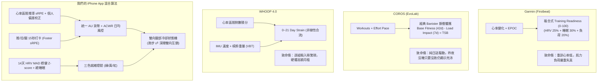

# 混合訓練排課演算法與業界標竿 (Garmin / COROS / WHOOP / Strava) 深度對比研究

> **建立日期**：2026-10-16  
> **研究定位**：評估當前專案《iPhone 混合訓練排課 App》與主流運動穿戴生態算法之代差、核心優勢與演進策略。

---

## 一、 核心對標結論總覽 (Executive Summary)

經過針對 **Garmin (Firstbeat)**、**COROS (EvoLab)**、**WHOOP 4.0** 與 **Strava** 四大穿戴與運動分析體系的演算法拆解，得出以下兩大關鍵結論：

1. **我們最具護城河的獨特優勢 (Our Distinct Edge)**：
   * **業界巨頭近乎 100% 偏重耐力運動**。無論是 Garmin 還是 COROS，其底層核心模型（EPOC 或 Banister CTL/ATL）皆基於心肺有氧數據。面對重量訓練時，手錶因心率偏低而嚴重低估中樞神經與肌纖維微創傷，且**完全不具備「雙向運動學衝擊仲裁」**（例如深蹲後隔天手錶依然叫你去跑間歇）。
   * 我們專案設計的 **「雙向肌群冷卻狀態機（跑步衝擊 ⇄ 下肢重訓冷卻）」**，精準填補了 Hybrid Athlete（混合體能愛好者）長年被穿戴大廠忽視的致命痛點。

2. **標竿系統能帶給我們的演進啟示 (Lessons Learned)**：
   * **COROS 的 Effort Pace**：戶外上下坡跑步或短衝刺時，心率存在生理滯後性；未來可藉由 Apple Watch 累計爬升與配速，對推導 sRPE 進行輕量化非線性補正。
   * **Garmin 的多維連續分數**：底層整合 HRV + 睡眠 + 急性負荷的多因素加權，提供更具連續性的 0~100 就緒度指標（作為輔助參考）。
   * **WHOOP 的教訓**：WHOOP Strength Trainer 雖精確但需逐組輸入重量次數，使用者負擔沉重；我們**必須堅守 < 15 秒極簡打卡**的產品留存本質。

---

## 二、 四大標竿系統算法深度拆解

---

## 三、 全維度橫向對比矩陣

| 比較維度 | Garmin (Firstbeat) | COROS (EvoLab) | WHOOP 4.0 | 我們的 iPhone 混合算法 |
|---|---|---|---|---|
| **核心目標族群** | 耐力跑者 / 戶外鐵人 | 專業馬拉松 / 越野跑者 | 綜合運動 / 健身潮流 | **混合體能愛好者 (路跑 + 重訓)** |
| **有氧負荷計算法** | EPOC 動態代謝模擬 | 區間時間積分 + 努力配速 | 24 小時心率對數累計 (0-21) | **心率區間加權推導 Foster sRPE (AU)** |
| **肌力負荷計算法** | 純心率換算 (嚴重低估) | 近乎忽略 (無專屬肌力模型) | 槓鈴移動速度 (VBT) + 動作重量 | **Foster sRPE 極簡打卡 (<15秒，時長×強度)** |
| **多運動衝突仲裁** | ❌ 無 (不知下肢微創傷) | ❌ 無 (純看總負荷平衡 TSB) | ❌ 無 (僅給予整體 Strain 目標) | **✅ 具備 (跑步衝擊 ⇄ 下肢重訓雙向冷卻)** |
| **恢復狀態指標** | 0~100 Training Readiness | 僅提供疲勞度 TSB (無睡眠整合) | 0~100% Recovery 恢復度 | **三色燈號 (綠/黃/紅) + 信心度標註** |
| **HRV 統計基準** | 7 天夜間 vs 21 天基線 | 晨間手動靜態測量 | 睡眠最後一個慢波期取樣 | **14 天中位數 + MAD 穩健 Z-Score** |
| **間歇/爬坡補正** | 心率滯後算法補償 | Effort Pace 物理坡度換算 | 速度傳感補正 | **個人偏差係數 $\text{PersonalBias}$** |
| **穿戴設備門檻** | 綁定 Garmin 專用手錶 | 綁定 COROS 專用手錶 | 綁定 WHOOP 手環 (月租費) | **通用 Apple Watch (WorkoutKit 原生同步)** |

---

## 四、 演算法演進建議與結論

1. **Phase 1 MVP 堅守凍結規格 (Stick to v1.2)**：
   * 目前 `v1.2` 規格中的「Foster sRPE 雙軌正規化」、「ACWR 啟發式提醒」、「雙向腿部冷卻」與「Gate 1~5 驗收門檻」邏輯扎實，**在混合訓練領域已超越 Garmin 與 COROS**，切勿在未跑 Spike 前盲目增加複雜度。
2. **Phase 2 候選演進點（待實測數據回饋後評估）**：
   * **吸收 COROS 優點**：評估引入 Apple Watch 的爬升數據，為爬坡與間歇跑提供推導 sRPE 的非線性強化補正。
   * **吸收 Garmin 優點**：在三色燈號底層計算一個連續型的 0~100 參考數值，提供更細膩的進度回饋。
