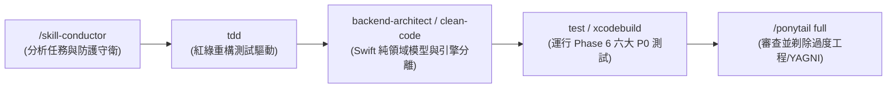

# iPhone 混合訓練自適應排課系統：專案完整交接與工程接力手冊 (Master Handoff & Conductor Guide)

> **版本**：v2.0 (PRD 完整簽核結案與工程實作接力版)  
> **更新日期**：2026-10-17  
> **目標設備**：iPhone Only (iOS 17.0+) 搭配 Apple Watch / WorkoutKit 生態  
> **交接狀態**：Phase 1～Phase 6 全規格書 100% 簽核完畢，進入 Swift 套件實作與測試階段。

---

## 🧭 一、 專案檔案清單與資產打包總覽 (File Deliverables Manifest)

專案所有架構規格、驗收標準、基準分析與原型檔案均集中存放於 `e:\Build\docs\`：

| 檔案名稱與連結 | 類型 / 版本 | 核心職責與關鍵內容 |
| :--- | :--- | :--- |
| 📘 [training_app_spec.md](file:///e:/Build/docs/training_app_spec.md) | **單一事實來源 PRD**<br/>`v2.0 (916行)` | **系統最核心規格書**。完整涵蓋 Phase 1（願景與3大旅程）、Phase 2（Foster sRPE × Duration AU、SMA ACWR、MAD Z-Score）、Phase 3（4大動作模式、冷卻折減、雙向衝擊矩陣、雙層換課）、Phase 4（50% Smart Merge、時間回推、對帳）、Phase 5（純 Swift 領域模型與 SwiftData 適配器）、Phase 6（6大 P0 BDD 邊界測試案例）。 |
| 📋 [spike_acceptance_criteria.md](file:///e:/Build/docs/spike_acceptance_criteria.md) | **實機探針標準**<br/>`v1.2` | 五大 Gate 量化驗收門檻：Gate 1（HRV 夜間取樣頻率與穩健 Baseline）、Gate 2（心率區間動態積分誤差 $\le 7\%$ 與 sRPE MAE $\le 1.0$）、Gate 3（睡眠時數合併去重）、Gate 4（WorkoutKit 排程回調）、Gate 5（4～8 週歷史回測模擬）。 |
| 📊 [algorithm_benchmark_analysis.md](file:///e:/Build/docs/algorithm_benchmark_analysis.md) | **業界競品對標**<br/>`v1.0` | 深度對比 Garmin (Firstbeat)、COROS (EvoLab)、WHOOP 4.0 與 Strava。論證為何採用 Foster AU、為何切分 4 大動作模式，以及攻克穿戴大廠「肌力微創傷失明」的核心護城河。 |
| 📱 [ui_prototype.html](file:///e:/Build/docs/ui_prototype.html) | **高保真互動原型**<br/>`HTML/CSS/JS` | 純 iPhone 15/16 Pro 深色模式高保真原型。包含：動態晨間排課卡片、一鍵換課 Modal、WorkoutKit 送錶動畫、<15秒極簡打卡滑桿、肌肉冷卻狀態視覺化。 |
| 🎨 [ui_design_spec.md](file:///e:/Build/docs/ui_design_spec.md) | **UI 設計系統規範**<br/>`v1.0` | 組件層級樹、Design Tokens（色彩語義、SF Pro 字階、8pt 網格）、觸覺反饋 (Haptic Feedback) 規範與無障礙 Dynamic Type 支援。 |
| 🛠️ [HealthKitSpikeService.swift](file:///e:/Build/docs/HealthKitSpikeService.swift) | **Swift 探針服務**<br/>`Prototype` | 封裝 HealthKit / WorkoutKit 實機探針邏輯。包含 14 天夜間 HRV 查詢、心率離散時間差加權積分、睡眠區間去重合併、WorkoutKit 課表推送。 |
| 🧠 [TrainingConflictResolver.swift](file:///e:/Build/docs/TrainingConflictResolver.swift) | **衝突仲裁原型**<br/>`Prototype` | 早期演算法驗證腳本。待後續工程師依據 Phase 5 契約重構成 `TrainingPolicyEngine.swift`。 |

---

## 🔒 二、 已拍定之核心架構與運動科學決策 (Settled Architecture Decisions)

接力者切勿推翻以下已經過 6 階段驗證並簽核的底層鐵律：

1. **設備邊界 (Target Device)**：
   * **iPhone Only (iOS 17.0+)**，採直向單手操作。不適配 iPadOS，維持最高開發聚焦。
2. **無 watchOS App 負擔 (WorkoutKit-First)**：
   * 透過 Apple 原生 `WorkoutKit` (`WorkoutScheduler.shared.schedule(WorkoutPlan, at: dateComponents)`) 直接推送至 Apple Watch 內建體能訓練 App。
   * 免除獨立開發 watchOS App 之高昂維護成本，同時享有原生常亮與震動警示。
3. **極簡肌力打卡 (<15 秒無痛流程)**：
   * 捨棄組間輸入重量/次數的過度工程；僅需選擇 4 大動作模式 + 時長 + Foster sRPE 滑桿，大幅提升混合運動員長期依從性。
4. **統一負荷貨幣 (Unified Load Currency)**：
   * 雙軌唯一負荷貨幣為 **Foster AU ($\text{Duration} \times \text{sRPE}$)**。
   * 心率區間依據對照表推導有氧 sRPE，並由使用者歷史中位數偏差 $\text{PersonalBias}$ 自動校正。
5. **ACWR 統計與保底機制**：
   * 急性負荷 $\text{ATL} = 7\text{d SMA}$，慢性負荷 $\text{CTL} = 28\text{d SMA}$。
   * 設有 $\text{CTL}_{\min} = 30.0\text{ AU/day}$ 保護下限，防止久未運動重啟時 ACWR 暴衝至無窮大。
   * ACWR 僅作為啟發式警示，**絕不強制鎖死**排程。
6. **4 大動作模式與冷卻折減**：
   * 捨棄模糊肌群，統一採用：`upperPush` (推), `upperPull` (拉), `lowerQuad` (下肢膝主導), `lowerPosterior` (下肢髖主導/後側鏈)。
   * 單一部位 100% 冷卻；同日多部位打卡，主項 100%，輔項享 0.7 折減。
   * 跑步高強度/長距離對下肢施加 36～48h 冷卻；下肢大重量重訓後 48h 限制高強度跑步。
7. **資料去重與時間回推閉環**：
   * 手錶訓練與 App 手動打卡重疊度 $\ge 50\%$ 時自動觸發 Smart Merge，以單筆會話入帳，絕不雙重累計。
   * 跨夜或延遲補打卡以實際結束時間為時間戳記錨點，精準回推剩餘冷卻時數。
8. **領域模型與儲存分離 (Clean Architecture)**：
   * 演算法純邏輯使用不可變純 Swift `struct` (`WorkoutSession`, `PhysiologicalSnapshot`, `DailyDecision`)，完全不依賴 SwiftData 或 UIKit；透過 `StorageAdapter` 進行持久化轉換。

---

## 🤖 三、 接力者使用指南：如何使用 `/skill-conductor` 與 `/handoff`

未來的 AI 協作者或工程師接手本專案時，請遵循以下標準作業程序 (SOP)：

### 1. 使用 `/skill-conductor` 啟動工程落地 (Next Phase Dispatch)

接下來的工作屬於 **Tier 2 (Standard) ~ Tier 3 (Complex)** 的工程實作任務（建立 SPM 套件、撰寫純領域核心引擎、落實 Phase 6 BDD 測試案例）。

#### 調度指令範例
當接力者開啟新對話時，可直接輸入以下指令調用 Conductor：
```text
/skill-conductor "依據 docs/training_app_spec.md Phase 5 契約與 Phase 6 驗收案例，建立 HybridTrainingEngine Swift Package，實作純領域核心引擎與 XCTest 單元測試"
```

#### Conductor 建議執行鏈 (Dispatch Chain)


#### 接力時的 Guardrails (鐵律守則)
* **禁止循環調用**：調度鏈中不可再喚起 `skill-conductor` 本身。
* **純 Swift 原則**：核心演算法模組嚴禁直接 `import HealthKit`、`import SwiftData` 或 `import UIKit`，所有時間與歷史資料必須由外部 Protocol / Struct 注入，確保 100% 本地單元測試覆蓋。
* **命名零分裂**：Swift 檔案內的 Enum Case 與 Struct 屬性必須與 `training_app_spec.md` 第 5 章 100% 完全一致。

---

### 2. 使用 `/handoff` 維護跨工作階段狀態

若後續任務較長、需要跨階段暫停或轉移給另一個 Agent，請隨時使用 `/handoff` 技能：

1. **觸發方式**：
   輸入 `/handoff "說明當前完成的程式碼進度與下一個 Agent 的目標"`。
2. **輸出位置**：
   系統將自動於作業系統暫存目錄（Windows: `%TEMP%`，即 `C:\Users\Harry\AppData\Local\Temp\`）生成最新摘要，同時同步更新 [handoff_summary.md](file:///e:/Build/docs/handoff_summary.md)。
3. **交接規範**：
   * 不重複張貼已存在於 `training_app_spec.md` 的演算法內文，一律使用路徑錨點鏈接。
   * 列出具體完成的檔案路徑與行數。
   * 明確列出下一個 Agent 必須啟動的 `suggested skills`。

---

## 🚀 四、 下一階段具體行動清單 (Immediate Action Items)

接力者請立即依照下列優先級推進：

### 優先級 1 (P0)：建立獨立 Swift Package 架構
在 `e:\Build\` 下建立目錄 `HybridTrainingEngine`，並配置標準 `Package.swift`：
```text
HybridTrainingEngine/
├── Package.swift
├── Sources/
│   └── HybridTrainingEngine/
│       ├── Domain/          // 包含 Phase 5 定義之純 Swift Structs & Enums
│       │   ├── MovementPattern.swift
│       │   ├── WorkoutSession.swift
│       │   ├── PhysiologicalSnapshot.swift
│       │   └── DailyDecision.swift
│       ├── Engine/          // 演算法核心純函式邏輯
│       │   ├── FosterLoadCalculator.swift
│       │   ├── ACWRCalculator.swift
│       │   ├── RobustZScoreCalculator.swift
│       │   ├── MuscleCooldownEngine.swift
│       │   └── TrainingPolicyEngine.swift
│       └── StorageAdapter/  // SwiftData @Model 雙向轉換器
│           └── SDWorkoutSessionAdapter.swift
└── Tests/
    └── HybridTrainingEngineTests/
        └── AcceptanceTests/ // Phase 6 的 6 大 P0 邊界測試案例
            ├── TwoADayTests.swift
            ├── DetrainingResetTests.swift
            ├── DirtyHeartRateTests.swift
            ├── DelayedTimeOffsetTests.swift
            ├── SmartMergeTests.swift
            └── InjuryGateTests.swift
```

### 優先級 2 (P0)：編寫 Phase 6 BDD 單元測試 (TDD Red-Green)
將 `training_app_spec.md` 第 6.2 節的 6 個 Given/When/Then 案例轉化為具體的 XCTest 測試方法：
1. `test_twoADay_accumulatesLoad_andMaintainsIndependentCooldown()`
2. `test_detrainingReset_appliesCTLFloor_preventsDivisionByZero()`
3. `test_dirtyHeartRate_clampsDeltaT_andFlagsManualConfirmation()`
4. `test_delayedLog_anchorsToHistoricalEndTime_calculatesRemainingHours()`
5. `test_smartMerge_overlapsAbove50Percent_unifiesIntoSingleSession()`
6. `test_injuryGate_blocksImpactWorkouts_allowsManualUserOverride()`

### 優先級 3 (P1)：實機 HealthKit / WorkoutKit Spike 驗證
* 結合 [HealthKitSpikeService.swift](file:///e:/Build/docs/HealthKitSpikeService.swift) 與 [spike_acceptance_criteria.md](file:///e:/Build/docs/spike_acceptance_criteria.md)，引導使用者在配對的實體 iPhone + Apple Watch 執行探針，驗收 Gate 1～Gate 4。

---

> 💡 **小結提示**：所有前置運動科學論證、架構決策與邊界防護已固若金湯。接力者只需閱讀本手冊與 [training_app_spec.md](file:///e:/Build/docs/training_app_spec.md)，即可透過 `/skill-conductor` 迅速展開高品質工程實作！
