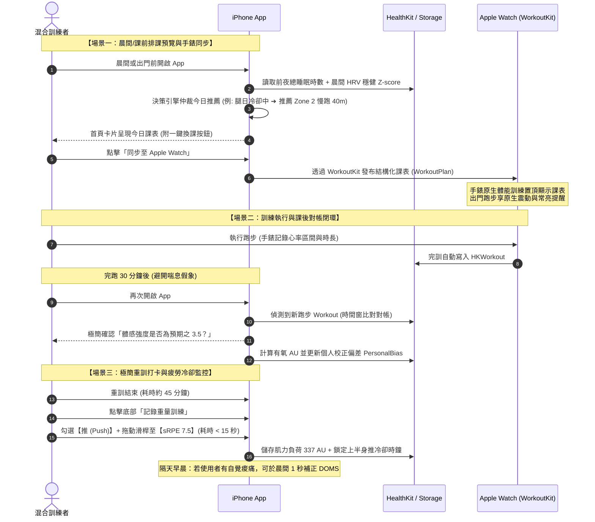
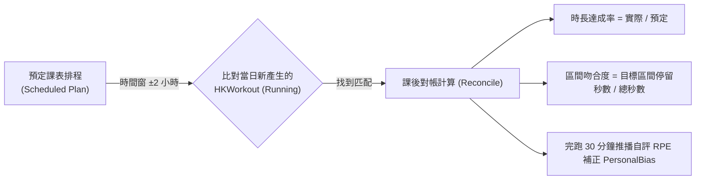

# iPhone 混合訓練自適應排課系統：產品需求與工程架構規格書 (Single Source of Truth PRD)

> **版本**：v2.0  
> **目標設備**：iPhone Only (iOS 17.0+) 搭配 Apple Watch / WorkoutKit 生態  
> **維護模式**：6 階段漸進式生成與多維審查

---

## 📌 規格書撰寫進度追蹤器 (Progress Tracker)

- [x] **Phase 1：產品願景、核心痛點與雙軌使用者旅程 (User Journey)** `[已完成]`
- [x] **Phase 2：生理準備度與運動科學演算法規格 (Algorithm & Math Spec)** `[已完成]`
- [x] **Phase 3：雙軌衝突仲裁與肌群冷卻矩陣 (Conflict Resolution & Cooldown Matrix)** `[已完成]`
- [x] **Phase 4：Apple Watch / HealthKit 資料同步與去重閉環 (Data Sync & Deduplication)** `[已完成]`
- [x] **Phase 5：核心資料模型與前後端共用契約 (Data Models & Enum Contracts)** `[已完成]`
- [x] **Phase 6：驗收標準與極端邊界測試案例 (Acceptance Criteria & Edge Cases)** `[已完成]`

---

## 📜 目錄 (Table of Contents)

1. [Phase 1: 產品願景、核心痛點與雙軌使用者旅程](#phase-1-產品願景核心痛點與雙軌使用者旅程)
2. [Phase 2: 生理準備度與運動科學演算法規格](#phase-2-生理準備度與運動科學演算法規格)
3. [Phase 3: 雙軌衝突仲裁與肌群冷卻矩陣](#phase-3-雙軌衝突仲裁與肌群冷卻矩陣)
4. [Phase 4: Apple Watch / HealthKit 資料同步與去重閉環](#phase-4-apple-watch--healthkit-資料同步與去重閉環)
5. [Phase 5: 核心資料模型與前後端共用契約](#phase-5-核心資料模型與前後端共用契約)
6. [Phase 6: 驗收標準與極端邊界測試案例](#phase-6-驗收標準與極端邊界測試案例)
   * 6.1 測試策略與驗收原則 (Testing Strategy & Philosophy)
   * 6.2 P0 核心極端邊界測試用例 (Given / When / Then)
     * Case 1: 一日兩練 (Two-a-Day Workouts) 雙軌累計與獨立冷卻
     * Case 2: 長時間中斷重啟 (Detraining / Reset) 與 CTL 保護下限
     * Case 3: 手錶心率脫落與超長暫停 (Dirty HealthKit Data) 防呆與自動填寫提醒
     * Case 4: 跨夜延遲補打卡 (Time Offset) 剩餘冷卻回推精確性
     * Case 5: 雙重寫入 (Apple Watch + App 打卡) 50% 智慧合併去重
     * Case 6: 傷病安全閘門即時介入與手動覆寫防線
   * 6.3 驗收通過簽核清單 (Sign-Off Checklist)
7. [附錄：變更紀錄 (Changelog)](#附錄變更紀錄-changelog)

---

## Phase 1: 產品願景、核心痛點與雙軌使用者旅程

### 1.1 產品定位與核心願景
本產品是一款專為 **「混合體能運動員 (Hybrid Athlete)」** 量身打造的純 iPhone 原生智能訓練排程工具。透過深度整合 Apple Watch 與 HealthKit 生理數據，在端側本地運行雙軌自適應演算法，動態協調 **「耐力路跑」** 與 **「肌力重訓」** 之間的疲勞累積與運動學衝突，讓運動員在提升心肺耐力的同時兼顧力量發展，避免過度訓練與不必要的疲勞干擾。

### 1.2 目標受眾與使用者畫像 (Persona)
* **主要族群**：每週規律運動 3～5 次的混合訓練愛好者（同練路跑與重量訓練）。
* **行為特徵**：
  * 日常佩戴 Apple Watch 記錄睡眠、靜止心率、HRV 與跑步數據。
  * 熟悉基本的重量訓練動作與配速概念，自主在健身房或戶外訓練。
  * 具備明確的運動自律性，不需要社交動態牆激勵或基礎教學影片指導。
* **次要族群**：準備半馬/全馬且希望維持基本肌肉量防受傷的跑者，或熱愛重訓並希望建立扎實 Zone 2 有氧底層的健身者。

### 1.3 核心痛點深度剖析
1. **穿戴大廠對肌力微創傷「失明」**：Garmin、COROS、Strava 等既有生態高度偏重耐力運動，重訓時因心率偏低被視為低負荷，導致深蹲硬舉次日手錶依然開出高強度間歇跑課表。
2. **缺乏雙向運動學衝突仲裁**：耐力長跑後的下肢離心衝擊（DOMS）與大重量深蹲互相干擾，運動員難以自行拿捏何時該跑、何時該推拉、何時該完全休息。
3. **主流健身軟體操作負擔過重**：多數重訓 App 強制在組間逐動態輸入「每組次數、重量、RPE」，在汗流浹背時操作摩擦力極大，導致數週後使用者大量流失。

### 1.4 核心價值主張與三大邊界承諾
* **啟發式自適應教練 (Adaptive Coach)**：每天提供「唯一最佳推薦」，同時附帶「一鍵換課 (Swap)」安全替代方案，保有專業引導與個人行程彈性。
* **極低摩擦力承諾 (< 15 秒打卡)**：重訓僅需打卡「部位 + 時間 + Foster sRPE」，兩次點擊即可精確入帳肌力負荷。
* **Local-First 競技工具流**：
  * **100% 本地端離線運作**：無雲端帳號綁定、無訂閱登入牆、無伺服器等待延遲（冷啟動 < 0.5 秒）。
  * **零社交噪音**：無動態牆、無社群推播、無花俏 3D 動作庫，專注於高效排程與數據對帳。

### 1.5 每日 3 大核心場景與端對端使用者旅程 (End-to-End User Journey)



---

## Phase 2: 生理準備度與運動科學演算法規格

### 2.1 統一運動負荷貨幣 (Unified Session Load)
為了讓不同能量代謝系統（心肺有氧 vs 神經肌力）能夠在同一決策模型中正規化，系統採用經典的 **Foster's Session RPE (sRPE)** 作為單次訓練負荷的任意單位（Arbitrary Units, AU）：

$$\text{Session Load (AU)} = \text{Duration (min)} \times \text{sRPE (1.0 ～ 10.0)}$$

* **肌力訓練 (Strength)**：由使用者在 App 內打卡輸入的實際時長與主觀 sRPE 直接相乘。
* **耐力跑步 (Running)**：由 HealthKit 記錄的跑步時長與「心率區間加權推導之等效 sRPE」相乘。

---

### 2.2 有氧心率區間推導 sRPE 與個人校正偏差 (Personal Bias)

#### 1. 預設區間基準表 (Baseline RPE Mapping)
系統依據各心率區間在運動生理學中的代謝特徵，設定一組預設基準 Base RPE（註明：此為工程啟發式預設假設，非通用生理絕對值）：

| 心率區間 | 心率範圍 (% MaxHR) | 預設基準 $\text{BaseRPE}_i$ | 生理特徵描述 |
|---|---|---|---|
| **Zone 1** | 50% ～ 60% | **2.0** | 極輕鬆恢復跑、熱身，幾乎無乳酸累積 |
| **Zone 2** | 60% ～ 70% | **3.5** | 有氧基底耐力跑、脂肪燃燒、可全程輕鬆交談 |
| **Zone 3** | 70% ～ 80% | **5.5** | 節奏跑 (Tempo)、略感吃力、需專注呼吸調節 |
| **Zone 4** | 80% ～ 90% | **7.5** | 乳酸閾值跑 (Threshold)、間歇衝刺、呼吸急促 |
| **Zone 5** | > 90% | **9.5** | 無氧極限衝刺 (VO2 Max)、極度痛苦、無法維持超過數分鐘 |

#### 2. 時間加權推導公式
單次跑步由手錶記錄之心率樣本，計算在各區間內的停留秒數 $T_i$，加權推導出基礎 sRPE：

$$\text{BaseDerivedRPE} = \sum_{i=1}^5 \left( \frac{T_i}{\sum_{k=1}^5 T_k} \times \text{BaseRPE}_i \right)$$

#### 3. 個人偏差動態校正機制 (Personal Bias Correction)
為消除天氣炎熱、咖啡因、心率漂移或短間歇延遲造成的個體系統性誤差，系統引入個人偏差校正項 $\text{PersonalBias}$：

$$\text{Derived sRPE} = \text{clamp}\Big(\text{BaseDerivedRPE} + \text{PersonalBias}, \; 1.0, \; 10.0\Big)$$

* **校正項計算規則**：
  * 初始預設值：$\text{PersonalBias}_0 = 0.0$。
  * 每次完跑後 30 分鐘，使用者自評回報 $\text{SelfRatedRPE}$。
  * 記錄單次誤差：$e_j = \text{SelfRatedRPE}_j - \text{BaseDerivedRPE}_j$。
  * 累積滿 5 次跑步紀錄後，取近 10 次誤差之**中位數**更新：
    $$\text{PersonalBias} = \text{clamp}\Big(\text{Median}(e_1, e_2, \dots, e_m), \; -1.5, \; +1.5\Big)$$

---

### 2.3 急性與慢性負荷模型 (ATL / CTL / ACWR)
系統採用簡單滾動移動平均（SMA），以確保數值透明、可解釋、無遞迴狀態依賴：

#### 1. 急性負荷 (Acute Training Load, ATL)
反映短期疲勞累積，取近 7 天日均負荷：
$$\text{ATL}_d = \frac{1}{7} \sum_{t=0}^6 \text{Load}_{d-t}$$

#### 2. 慢性負荷 (Chronic Training Load, CTL)
反映長期體能儲備與抗疲勞基底，取近 28 天日均負荷。為防止除以零或剛安裝時分母過小造成數值暴衝，設立保護下限常數 $\text{CTL}_{\min} = 30.0\text{ AU/day}$：
$$\text{CTL}_d = \max\left( \frac{1}{28} \sum_{t=0}^{27} \text{Load}_{d-t}, \; 30.0 \right)$$

#### 3. 急慢性負荷比 (Acute:Chronic Workload Ratio, ACWR)
$$\text{ACWR}_d = \frac{\text{ATL}_d}{\text{CTL}_d}$$

* **中性啟發式區間定性（啟發式提醒，非不可逆硬閘門）**：
  * **$\text{ACWR} < 0.8$【負荷偏低】**：體能刺激不足，系統建議可適度提升運動時長或強度。
  * **$0.8 \le \text{ACWR} \le 1.3$【穩健甜蜜區】**：增量平穩，適宜維持常態週期排程。
  * **$1.3 < \text{ACWR} \le 1.5$【負荷增加提醒】**：短期訓練增量偏快，課表偏向中低強度，並發出中性提醒。
  * **$\text{ACWR} > 1.5$【顯著高負荷】**：累積疲勞遠高於過去月均，強烈建議安排主動恢復跑或休息；**使用者可在介面上一鍵手動覆寫**。

---

### 2.4 冷啟動混合模型 (Cold-Start Blended Model)
新用戶初次使用時，缺乏完整的 28 天歷史紀錄，系統透過「優先回填 + 動態漸進混合」確保無縫銜接：

1. **優先歷史回填**：安裝時經 HealthKit 授權，自動抓取過去 28 天內的所有 `HKWorkout`。歷史跑步由心率推導 AU；歷史重訓若缺 sRPE 則暫時代入預設值 $6.0$。
2. **無完整歷史時之問卷初始基準**：
   * **初階混合者**：每週約 3 次 $\rightarrow \text{Baseline CTL} = 85.0\text{ AU/day}$（約 600 AU/週）。
   * **中階混合者**：每週約 4 次 $\rightarrow \text{Baseline CTL} = 170.0\text{ AU/day}$（約 1200 AU/週）。
   * **進階混合者**：每週約 5 次 $\rightarrow \text{Baseline CTL} = 255.0\text{ AU/day}$（約 1800 AU/週）。
3. **第 1 ～ 27 天動態混合過渡公式**（$N$ 為已記錄的真實天數，$1 \le N \le 27$）：
   $$\text{CTL}_{\text{blended}} = \left( \frac{\sum_{k=1}^N \text{Load}_k}{N} \right) \times \frac{N}{28} + \text{Baseline CTL} \times \frac{28 - N}{28}$$
   滿 28 天後完全轉為真實 28 天滾動平均。

---

### 2.5 自律神經與睡眠準備度評估 (HRV MAD & Sleep Scoring)

#### 1. HRV (SDNN) 穩健統計模型
Apple Watch 在睡眠期間自動採樣 SDNN（毫秒 ms）。為消除單夜作夢或偶發酒精干擾，採用中位數與絕對離差中位數（MAD）：

* **14 天滾動中位數**：$\text{Median}_{14d} = \text{Median}(\text{HRV}_{d-13}, \dots, \text{HRV}_d)$
* **絕對離差中位數 (MAD)**：
  $$\text{MAD}_{14d} = \text{Median}\Big( \big| \text{HRV}_t - \text{Median}_{14d} \big| \Big)$$
* **穩健 Z-Score 計算（設 2.0ms 保護下限）**：
  $$\text{Robust } Z_{\text{HRV}} = \frac{\text{HRV}_{\text{today}} - \text{Median}_{14d}}{1.4826 \times \max(\text{MAD}_{14d}, 2.0)}$$

#### 2. 睡眠總時數評分標準
排除 `.inBed` 臥床時間，經多來源去重後計算純睡眠時長 $\text{SleepDuration}$（小時）：
* $\text{SleepDuration} \ge 7.5\text{h}$：評估為滿分恢復（基礎分 100）。
* $6.5\text{h} \le \text{SleepDuration} < 7.5\text{h}$：評估為良好恢復（基礎分 80）。
* $5.0\text{h} \le \text{SleepDuration} < 6.5\text{h}$：評估為輕度不足（基礎分 55）。
* $\text{SleepDuration} < 5.0\text{h}$：評估為嚴重不足（基礎分 30）。

---

### 2.6 綜合生理準備度雙層架構 (Readiness Score & Traffic Light)

系統對內計算連續型數值（0 ～ 100 分），對外以三色燈號直覺呈現：

#### 1. 0 ～ 100 底層準備度連續分數合成公式
$$\text{ReadinessScore} = \text{clamp}\Big( 50 + 20 \times \text{clamp}(Z_{\text{HRV}}, -2.5, 2.5) + 0.35 \times (\text{SleepScore} - 70) - 15 \times (\text{ACWR} - 1.0), \; 0, \; 100 \Big)$$

* **資料不足時之降級機制**：若當夜無有效 HRV 數據，HRV 項置零，比重自動轉移至睡眠總時長與晨間主觀活力，並在 UI 上標示「低信心度 (Low Confidence)」。

#### 2. 頂層三色燈號決策輸出
* 🟢 **綠燈【Ready / 準備充分】（$\text{ReadinessScore} \ge 70$）**：
  * 自律神經與睡眠充沛，系統允許解鎖高強度課表（如：閾值節奏跑、無氧間歇、大重量主項訓練）。
* 🟡 **黃燈【Moderate / 狀態持平】（$45 \le \text{ReadinessScore} < 70$）**：
  * 生理處於吸收適應期，系統優先推薦中低強度刺激（如：Zone 2 基底慢跑、中等次數輔助肌耐力訓練）。
* 🔴 **紅燈【Fatigued / 疲勞偏高】（$\text{ReadinessScore} < 45$）**：
  * 自律神經顯著受抑制或嚴重缺眠，系統推薦主動恢復（Active Recovery 慢跑 20 分鐘、伸展 Mobility）或完全休息。

---

## Phase 3: 雙軌衝突仲裁與肌群冷卻矩陣

### 3.1 4 大動作模式與肌群映射 (Movement Patterns)
為了精確隔離肌群微創傷，特別是防範耐力跑對膕繩肌與下肢關節的衝擊，系統摒棄粗糙的腿部單一分類，嚴格採用運動機能學的 **4 大動作模式**：

| 動作模式識別碼 | 模式中文名稱 | 主要動態肌群 | 代表性動作範例 | 跑步交互影響敏感點 |
|---|---|---|---|---|
| **`upperPush`** | 上半身推 | 胸大肌、三角肌前束、肱三頭肌 | 槓鈴臥推、俯臥撐、啞鈴肩推、雙槓臂屈伸 | 極低（無下肢直接交互干擾） |
| **`upperPull`** | 上半身拉 | 背闊肌、斜方肌、菱形肌、肱二頭肌 | 引體向上、滑輪下拉、槓鈴划船、面拉 | 極低（提供跑步軀幹穩定支撐） |
| **`lowerQuad`** | 下肢膝主導 (前側) | 股四頭肌、臀大肌、內收肌群 | 槓鈴後深蹲、前深蹲、分腿蹲 (Lunge)、腿推機 | **高衝擊**：落地緩衝與離心支撐，疲勞時易膝痛 |
| **`lowerPosterior`** | 下肢髖主導 (後側鏈) | 膕繩肌群 (Hamstrings)、臀大肌、豎脊肌 | 傳統硬舉、羅馬尼亞硬舉 (RDL)、臀橋、腿彎舉 | **極高危**：快速後蹬與高步頻拉傷之首要高發區 |

* **極簡 UI 打卡對應**：在 App 打卡介面中，提供 4 顆直覺大膠囊按鈕：`[推 (Push)]`、`[拉 (Pull)]`、`[前側/深蹲 (Quads)]`、`[後側/硬舉 (Posterior)]`。使用者可單選或多選。

---

### 3.2 基礎冷卻時間與主/輔項動態折減機制

#### 1. 專項單一部位打卡之基礎冷卻時間 (Baseline Cooldown)
當單次訓練僅專注於單一部位時，冷卻小時數完全取決於自評主觀強度 $\text{sRPE}$：

$$\text{Cooldown Hours} = \text{BaseHours} \times \text{IntensityFactor}$$

| 自評強度 sRPE | 強度分級描述 | 上半身 (`upperPush` / `upperPull`) | 下肢 (`lowerQuad` / `lowerPosterior`) |
|---|---|---|---|
| **$sRPE < 5.0$** | 輕度活動度 / 肌耐力 | **12 小時** (半天) | **18 小時** |
| **$5.0 \le sRPE < 7.0$** | 中等體積肌肥大訓練 | **24 小時** (1 天) | **36 小時** (1.5 天) |
| **$7.0 \le sRPE \le 8.5$** | 接近力竭之強度訓練 | **36 小時** (1.5 天) | **48 小時** (2 天) |
| **$sRPE > 8.5$** | 極限力竭 / 大重量 PR | **48 小時** (2 天) | **60 小時** (2.5 天) |

#### 2. 同日多部位打卡之「主/輔項動態折減係數 (Volume Discount)」
當運動員進行全身日（Full Body）或同日訓練 2~3 個部位時，體積（Volume）與中樞神經神經疲勞被分散，次要輔項享有冷卻折減，避免全部位動輒鎖死：
* **主項標註 (Primary Focus)**：第 1 個選取的部位視為主項，承受 **100%** 基礎冷卻時數。
* **輔項折減 (Secondary Focus)**：第 2、3 個部位視為輔項，冷卻時數自動乘上 **0.7 折減係數**：
  $$\text{Cooldown}_{\text{secondary}} = \text{Cooldown}_{\text{base}} \times 0.7$$
  * *範例*：打卡「下肢後側鏈（主）+ 上半身拉（輔）」，時長 60m，sRPE 7.5 $\rightarrow$ `lowerPosterior` 鎖定 48h 冷卻，而 `upperPull` 僅鎖定 $36 \times 0.7 \approx 25$ 小時。

---

### 3.3 跑步對下肢肌群之衝擊冷卻矩陣 (Running-to-Legs Impact)
耐力跑步並非純粹心肺消耗，強烈的地面反作用力（GRF）與離心收縮會對下肢造成顯著的肌肉微創傷。系統依據跑步時長與心率區間，回推下肢各動作模式的冷卻時鐘：

| 跑步課表特徵 | 判定條件 (時長與區間) | 股四頭肌 (`lowerQuad`) 冷卻時間 | 後側鏈 (`lowerPosterior`) 冷卻時間 | 隔日重訓排程影響 |
|---|---|---|---|---|
| **低強度超慢跑 / 恢復跑** | Zone 1~2 且時長 $\le 45$ 分鐘 | **12 小時** | **12 小時** | 隔日可正常執行任何下肢重訓 |
| **標準有氧基底跑 (Base Run)** | Zone 2 且時長 45 ～ 60 分鐘 | **24 小時** | **24 小時** | 隔日建議優先排上半身，或中等強度腿 |
| **乳酸閾值節奏跑 (Tempo Run)** | Zone 3 累計時間 $\ge 20$ 分鐘 | **36 小時** | **36 小時** | 隔日建議避開深蹲與硬舉，轉為推/拉 |
| **高強度無氧間歇 / 衝刺跑** | Zone 4~5 累計時間 $\ge 10$ 分鐘 | **36 小時** | **48 小時** (後側鏈高危) | 隔日嚴禁排大重量硬舉/RDL，防膕繩肌拉傷 |
| **長距離耐力跑 (Long Run)** | 任何配速且總時長 $> 75$ 分鐘 | **48 小時** | **48 小時** | 48 小時內避免高強度下肢主項訓練 |

---

### 3.4 下肢重訓對跑步之衝擊限制矩陣 (Legs-to-Running Constraints)
當下肢某動作模式仍處於冷卻倒數中（未滿清零），排程引擎對當日跑步課表施加啟發式強度限制：

```
[下肢狀態：lowerQuad 冷卻中] ──────► 跑步限制：禁止大跨步衝刺，限 Zone 1~2 (保持高步頻短步幅)
[下肢狀態：lowerPosterior 冷卻中] ──► 跑步限制：嚴禁坡度跑與 Zone 4~5 間歇跑 (防膕繩肌急性拉傷)
[下肢狀態：全下肢冷卻中] ──────────► 跑步限制：建議純恢復超慢跑 (Zone 1) 或 完全休息
```

* **具體降級規則**：
  1. 若 `lowerPosterior` 剩餘冷卻時間 $> 24$ 小時：今日若有跑步排程，**最高強度鎖定為 Zone 2**，嚴格濾除節奏跑與間歇跑模板。
  2. 若 `lowerQuad` 剩餘冷卻時間 $> 24$ 小時：今日跑步總時長建議**不超過 40 分鐘**，避免股四頭肌離心疲勞導致髕骨肌腱過載。
  3. 若雙下肢皆冷卻中（剩餘 $> 36$ 小時）：首頁主推薦改為「上半身重訓」或「20 分鐘 Zone 1 超慢跑」；若使用者執意要跑，發出下肢疲勞提示並由使用者自主決定。

---

### 3.5 雙向衝突仲裁決策樹 (Bidirectional Decision Tree)

政策決策層 (`TrainingPolicyEngine`) 每日清晨或開啟 App 時，依照以下固定優先順序流轉仲裁：

```mermaid
flowchart TD
    Start["晨間決策觸發"] --> Gate_Injury{"傷病安全閘門？\n(用戶主動勾選急性不適)"}
    Gate_Injury -->|有疼痛/傷病| Out_Rest["輸出：建議完全休息或溫和活動度伸展 (Mobility)"]
    
    Gate_Injury -->|無傷病| Gate_ACWR{"7天 ACWR 疲勞風控？"}
    Gate_ACWR -->|ACWR > 1.5| Out_Recovery["輸出：高負荷警示，強烈建議主動恢復 (Zone 1 慢跑 20m)"]
    
    Gate_ACWR -->|ACWR ≤ 1.5| Gate_Readiness{"綜合生理準備度 (ReadinessScore)？"}
    Gate_Readiness -->|紅燈 (<45分)| Out_Light["輸出：自律神經偏低，建議休息或低強度伸展"]
    
    Gate_Readiness -->|黃燈或綠燈 (≥45分)| Check_LongRun{"今日是否為長跑偏好日？\n(例: 週六)"}
    
    Check_LongRun -->|是| Check_LegCooldown{"前一日腿部是否深層冷卻中？"}
    Check_LegCooldown -->|是| Out_WarnRun["輸出：發出下肢疲勞警示，但依然保留長跑課表供使用者自主決定"]
    Check_LegCooldown -->|否| Out_LongRun["輸出：最佳推薦 ➔ 執行長距離耐力跑 (Long Run)"]
    
    Check_LongRun -->|否| Check_MuscleStatus["檢查 4 大動作模式冷卻時鐘"]
    Check_MuscleStatus --> Decider{"哪項系統最充沛？"}
    Decider -->|下肢冷卻中 & 心肺充沛| Out_UpperOrZone2["推薦：上半身肌力 (Push/Pull) 或 Zone 2 短跑"]
    Decider -->|全身肌群冷卻中| Out_PureRun["推薦：標準 Zone 2 有氧跑 (45~60m)"]
    Decider -->|心肺疲勞 & 肌群充沛| Out_Strength["推薦：專項下肢深蹲/硬舉肌力課表"]
    Decider -->|各系統皆充沛 (綠燈)| Out_HardOption["推薦：高強度間歇跑 或 下肢大重量主項訓練"]
```

---

### 3.6 換課替代建議 (Swap Alternates) 演算法與自由庫覆寫

當主推薦課表不符合使用者當日行程、偏好或器材限制時，使用者可點擊卡片旁的「換課 (Swap)」按鈕。系統提供**兩層換課機制**：

#### 1. 第一層：運動學互補優先順序 (Smart Safe Alternates)
系統預設提供 2～3 個依照科學互補排序的安全選項（自動剔除衝擊衝突項）：
* **情境範例：主推薦為「Zone 2 耐力跑 40m」，因下肢 `lowerQuad` 剛練完深蹲仍在冷卻中**：
  * **次佳備選 1 (安全互補肌力)**：`upperPush`（胸肩推舉肌耐力訓練，時長 45m）。
  * **次佳備選 2 (無負擔拉伸)**：`Active Mobility & Core`（徒手核心與髖關節活動度，時長 20m）。
  * **次佳備選 3 (低心肺代謝)**：`upperPull`（背部引體與划船訓練，時長 45m）。
  * **系統安全濾除**：動態過濾掉任何包含 `lowerQuad`（深蹲）與高強度間歇跑的選項。

#### 2. 第二層：自由全庫隨機挑選與強制覆寫 (Full Library Override)
為尊重運動員的最高主觀裁決權，在互補備選項下方常駐按鈕：
* **「從訓練庫中自由選擇所有課表 (Browse Full Library)」**：
  * 點擊可瀏覽所有預設模板（包含當前冷卻中的下肢動作與高強度課表）。
  * 若使用者強制挑選了衝突項目（例如執意在深蹲次日選擇間歇跑），卡片會彈出**中性警示提示 (Non-blocking Warning)**：
    > *「提示：下肢股四頭肌仍在修復冷卻中（剩餘 22 小時）。此課表衝擊較大，請注意配速與落地緩衝，確認要切換嗎？」*
  * 使用者點擊「確認執行」即可覆寫，充分體現「啟發式引導，使用者自主」的核心哲學。

---

## Phase 4: Apple Watch / HealthKit 資料同步與去重閉環

### 4.1 HealthKit 資料權限與背景感知機制 (Observer Query)

#### 1. 最小必要讀取權限集合 (Read Permissions)
系統遵循隱私最小化原則，僅向使用者申請以下必要健康資料項之讀取授權：
* **`HKQuantityType.heartRateVariabilitySDNN`**：自律神經與恢復基線計算。
* **`HKQuantityType.restingHeartRate`**：生理壓力與疲勞狀態監控。
* **`HKQuantityType.heartRate`**：跑步運動期間之逐秒/逐樣本心率區間離散積分。
* **`HKCategoryType.sleepAnalysis`**：昨夜有效總睡眠時長計算。
* **`HKObjectType.workoutType()`**：讀取歷史跑步與體能訓練紀錄。

#### 2. 背景喚醒與前台觸發雙軌架構
由於 iOS 在手機鎖定時受硬體加密限制，HealthKit 資料不可讀取，系統採用以下可靠度最高架構：
* **主路徑（前台即時重算）**：每次使用者解鎖開啟 App（`scenePhase == .active`）時，於 0.5 秒內並行執行 HealthKit 查詢，保證使用者永遠看到最新、最準確的狀態。
* **輔助路徑（背景感知）**：註冊 `HKObserverQuery` 搭配 `enableBackgroundDelivery(for: .immediate)`。當 Apple Watch 完訓寫入時，觸發系統在背景準備快取標記，若在非鎖定狀態下可提早預先推算對帳。

---

### 4.2 補打卡時間偏移 (Time Offset) 與冷卻時鐘回推演算

使用者重訓後常因洗澡、更衣或聚餐無法立即打卡，系統提供「真實發生時間錨定」機制：

#### 1. 打卡時間戳記輸入
打卡介面預設為當前時間，但提供快速時間偏移選擇：
* `剛才 (Just Now)`：$T_{\text{end}} = \text{Date()}$
* `約 2 小時前 (2h ago)`：$T_{\text{end}} = \text{Date()} - 2\text{ hours}$
* `昨晚 (Last Night)`：$T_{\text{end}} = \text{Yesterday 20:00}$
* `自訂時間 (Custom)`：精準選擇訓練結束時間戳記。

#### 2. 冷卻時鐘動態回推公式
假設動作模式 $M$ 根據強度計算出總冷卻時間為 $H_{\text{total}}$（小時），訓練實際結束時間為 $T_{\text{end}}$，當前時間為 $T_{\text{now}}$：
* **已修復時數 (Elapsed Hours)**：
  $$H_{\text{elapsed}} = \frac{T_{\text{now}} - T_{\text{end}}}{3600}$$
* **當前剩餘冷卻時數 (Remaining Cooldown)**：
  $$H_{\text{remaining}} = \max\Big(0, \; H_{\text{total}} - H_{\text{elapsed}}\Big)$$
* *實務範例*：週五 20:00 練深蹲（$H_{\text{total}} = 48\text{h}$），週六 12:00（經過 16 小時）開啟 App 補打卡並選擇「昨晚 20:00」。系統冷卻時鐘直接呈現「已修復 16h，剩餘冷卻 32h」，精準反映真實生理進程。

---

### 4.3 手錶與 App 雙重寫入之「50% 重疊智慧合併」演算法 (Smart Merge)

當運動員佩戴 Apple Watch 啟動手錶內建體能訓練（產生心率曲線與時長），完訓後又在 App 內進行 15 秒打卡（標註部位與 sRPE）時，兩筆紀錄的時間區間會發生重疊。

#### 1. 50% 重疊觸發判定公式
設 App 打卡區間為 $[T_{s1}, T_{e1}]$，持續時間 $D_1 = T_{e1} - T_{s1}$；手錶寫入的 `HKWorkout` 區間為 $[T_{s2}, T_{e2}]$，持續時間 $D_2 = T_{e2} - T_{s2}$。
兩者交集長度為：
$$D_{\text{overlap}} = \max\Big(0, \; \min(T_{e1}, T_{e2}) - \max(T_{s1}, T_{s2})\Big)$$
當重疊佔較短者比例達到門檻：
$$\text{OverlapRatio} = \frac{D_{\text{overlap}}}{\min(D_1, D_2)} \ge 0.50 \quad (50\%)$$
系統自動觸發 **智慧合併機制 (Smart Merge)**，而非覆蓋或重複計入。

#### 2. 智慧合併三位一體規則
1. **時長與生理心率**：採用 Apple Watch 實測的精準時長與心率樣本（客觀生理依據）。
2. **動作模式與主觀強度**：採用 iPhone App 端打卡的動作部位（如 `lowerQuad`）與 Foster sRPE（運動學依據）。
3. **負荷入帳單一原則**：
   $$\text{Session Load} = D_2 (\text{手錶實測分鐘}) \times \text{sRPE} (\text{App 打卡強度})$$
   手錶原先產生的有氧熱量或重複活動量**完全不重複計入系統總負荷**，徹底根除雙重入帳。

---

### 4.4 跑步 WorkoutKit 課表對帳比對閉環 (Reconciliation)

當使用者將今日建議跑步課表（例如：Zone 2 慢跑 40m，預定目標 130~144 bpm）透過 WorkoutKit 推播到手錶執行後，系統於課後完成閉環對帳：



* **時間窗關聯規則**：若手錶回傳之跑步 `HKWorkout` 開始時間落於預定排程時間之 $\pm 2$ 小時內，視為該預定課表之實體執行。
* **對帳反饋指標**：
  * **時長達成率 (Duration Adherence)**：$\frac{\text{實際跑步分鐘}}{\text{預定跑步分鐘}}$。
  * **區間遵循率 (Zone Adherence)**：目標 Zone 2 停留秒數佔總跑步時間之比例。若區間遵循率 $< 60\%$（例如跑者衝太快漂移至 Zone 4），系統會記錄此高衝擊偏差，並在當日下肢冷卻時鐘中自動追加 12 小時額外修復時間。

---

### 4.5 權限拒絕與無手錶用戶之「優雅降級模式」規格 (Graceful Fallback)

系統保證在無 Apple Watch 或 HealthKit 權限被拒時，核心功能 100% 可用：

| 功能模組 | 標準模式 (有 Apple Watch + HealthKit) | 優雅降級模式 (無手錶 / 權限拒絕) |
|---|---|---|
| **生理準備度** | 睡眠總時數 + 14 天夜間 HRV 穩健 Z-Score | 晨間 1 秒自覺活力滑桿 (1~5分) + 手動睡眠時數點選（UI 標註「手動評估模式」） |
| **跑步負荷入帳** | 手錶心率樣本自動積分推導 sRPE | 使用者完跑後手動點擊「完跑打卡」，輸入時長與體感 sRPE |
| **跑步課表執行** | WorkoutKit 直接推播自訂區間至手錶原生體能訓練 | 畫面展示目標配速與心率區間文字建議，引導自主計時 |
| **重訓打卡與冷卻** | 15 秒打卡，支援與手錶 Workout 50% 智慧合併 | 15 秒打卡，完全本地計算，純依賴時間戳記回推冷卻 |
| **ACWR 疲勞風控** | 自動由雙軌運動數據滾動計算 | 依據手動打卡數據正常運算，規則與啟發式警示完全相同 |

---

## Phase 5: 核心資料模型與前後端共用契約

### 5.1 乾淨領域結構分離架構原則 (Clean Domain Architecture)

為了確保 Policy Engine 與運動科學數學模型具備極致的高可測性（Testability），系統採用 **純領域模型 (Pure Domain Struct)** 與 **SwiftData 持久化模型 (`@Model`)** 完全解耦的雙層架構：

```text
[ HealthKit Service ] ──────► [ Pure Domain Structs ] ◄────── [ SwiftData Storage ]
                                      │
                                      ▼
                        [ TrainingPolicyEngine ] (純函式運算)
                                      │
                                      ▼
                             [ DailyDecision ]
                                ┌─────┴─────┐
                                ▼           ▼
                        [ SwiftUI View ]  [ WorkoutKit ]
```

* **演算法層**：僅依賴標準 Swift 型別（無 `import SwiftData`、無 `import HealthKit`），所有計算皆為無副作用的純函式（Pure Functions），可在任何環境下於毫秒內執行單元測試。
* **資料庫層**：負責本機 SQLite/SwiftData 映射，並透過 `toDomain()` 與 `init(domain:)` 完成雙向無損轉換。

---

### 5.2 核心枚舉定義 (Core Enums Contract)

```swift
import Foundation

/// 訓練專業類別
public enum TrainingDiscipline: String, Codable, CaseIterable {
    case running    // 耐力路跑
    case strength   // 重量肌力訓練
    case mobility   // 活動度與伸展
    case rest       // 完全休息
}

/// 4 大動作模式 (與運動機能學 100% 對齊)
public enum MovementPattern: String, Codable, CaseIterable {
    case upperPush       // 上半身推 (胸、肩前、三頭)
    case upperPull       // 上半身拉 (背、二頭)
    case lowerQuad       // 下肢前側膝主導 (深蹲、分腿蹲)
    case lowerPosterior  // 下肢後側鏈髖主導 (硬舉、RDL、臀大肌)
}

/// 生理準備度三色燈號
public enum ReadinessGrade: String, Codable {
    case ready     // 🟢 綠燈：可執行高強度間歇或大重量主項 (Score >= 70)
    case moderate  // 🟡 黃燈：建議維持中低強度有氧或肌耐力 (45 <= Score < 70)
    case fatigued  // 🔴 紅燈：建議主動恢復 (Zone 1) 或休息 (Score < 45)
    case injured   // ⚠️ 傷病安全閘門觸發：鎖定受傷部位
}

/// 數據信心水準標記
public enum MetricConfidence: String, Codable {
    case high  // 高信心度：HRV 與睡眠樣本充足
    case low   // 低信心度：缺乏 HRV，由睡眠或自覺活力降級推算
}

/// 單次訓練來源追蹤 (Provenance Tracking)
public enum SessionSource: Codable, Equatable {
    case healthKitWorkout(hkUUID: UUID) // Apple Watch 自動同步之 Workout
    case manualLog                      // 使用者於 iPhone App 內手動 15 秒打卡
    case smartMerged(hkUUID: UUID)      // 50% 時間重疊後之智慧合併複合實體
}

/// 跑步結構化課表類型
public enum RunningWorkoutType: String, Codable {
    case recoveryRun   // Zone 1 超慢恢復跑
    case baseRun       // Zone 2 有氧基底耐力跑
    case tempoRun      // Zone 3 乳酸閾值節奏跑
    case intervalRun   // Zone 4~5 無氧間歇衝刺跑
    case longRun       // 週末長距離耐力跑
}
```

---

### 5.3 訓練與生理實體結構 (Entity Structs)

```swift
import Foundation

/// 單次訓練會話領域實體 (WorkoutSession)
public struct WorkoutSession: Identifiable, Codable {
    public let id: UUID
    public let startDate: Date
    public let endDate: Date
    public let discipline: TrainingDiscipline
    public let durationMinutes: Double
    public let sRPE: Double                       // Foster sRPE: 1.0 ~ 10.0
    public let movementPatterns: [MovementPattern]// 涉及之動作模式 (第 1 項視為主項)
    public let source: SessionSource              // 資料來源溯源
    public let averageHeartRate: Double?          // 平均心率 (手錶客觀數據)
    public let zoneDurationsSeconds: [Int: Double]? // 各 Zone 1~5 停留秒數
    
    public init(
        id: UUID = UUID(),
        startDate: Date,
        endDate: Date,
        discipline: TrainingDiscipline,
        durationMinutes: Double,
        sRPE: Double,
        movementPatterns: [MovementPattern] = [],
        source: SessionSource = .manualLog,
        averageHeartRate: Double? = nil,
        zoneDurationsSeconds: [Int: Double]? = nil
    ) {
        self.id = id
        self.startDate = startDate
        self.endDate = endDate
        self.discipline = discipline
        self.durationMinutes = durationMinutes
        self.sRPE = sRPE
        self.movementPatterns = movementPatterns
        self.source = source
        self.averageHeartRate = averageHeartRate
        self.zoneDurationsSeconds = zoneDurationsSeconds
    }
    
    /// 單次訓練負荷 (Arbitrary Units, AU)
    public var loadAU: Double {
        return durationMinutes * sRPE
    }
}

/// 每日晨間生理快照 (PhysiologicalSnapshot)
public struct PhysiologicalSnapshot: Codable {
    public let date: Date
    public let hrvTodayMs: Double?               // 當日 SDNN 毫秒
    public let hrv14dMedianMs: Double?           // 14 天中位數
    public let hrv14dMADMs: Double?              // 14 天絕對離差中位數
    public let sleepDurationHours: Double        // 昨夜去重總睡眠時數
    public let hasReportedPainOrInjury: Bool     // 傷病安全閘門
    public let morningSorenessRating: Double?    // 晨間整體 DOMS 痠痛評分 (1~5)
    
    public init(
        date: Date = Date(),
        hrvTodayMs: Double? = nil,
        hrv14dMedianMs: Double? = nil,
        hrv14dMADMs: Double? = nil,
        sleepDurationHours: Double,
        hasReportedPainOrInjury: Bool = false,
        morningSorenessRating: Double? = nil
    ) {
        self.date = date
        self.hrvTodayMs = hrvTodayMs
        self.hrv14dMedianMs = hrv14dMedianMs
        self.hrv14dMADMs = hrv14dMADMs
        self.sleepDurationHours = sleepDurationHours
        self.hasReportedPainOrInjury = hasReportedPainOrInjury
        self.morningSorenessRating = morningSorenessRating
    }
}

/// 肌群局部冷卻狀態模型
public struct MuscleCooldownStatus: Codable {
    public let pattern: MovementPattern
    public let remainingHours: Double           // 剩餘冷卻小時數
    public let lastStimulatedDate: Date?        // 前次刺激時間點
    public let isFatigued: Bool                 // 是否處於修復期 (remainingHours > 0)
    
    public init(pattern: MovementPattern, remainingHours: Double, lastStimulatedDate: Date?) {
        self.pattern = pattern
        self.remainingHours = remainingHours
        self.lastStimulatedDate = lastStimulatedDate
        self.isFatigued = remainingHours > 0
    }
}
```

---

### 5.4 決策與課表產出模型 (Decision & Workout Contracts)

```swift
import Foundation

/// 結構化課表步驟
public struct WorkoutStepItem: Identifiable, Codable {
    public let id: UUID
    public let order: Int
    public let name: String                      // 如 "Zone 2 基底慢跑"
    public let durationSeconds: Int              // 時長 (秒)
    public let targetHeartRateRange: ClosedRange<Double>? // 目標心率區間 (bpm)
    public let description: String
    
    public init(
        id: UUID = UUID(),
        order: Int,
        name: String,
        durationSeconds: Int,
        targetHeartRateRange: ClosedRange<Double>? = nil,
        description: String
    ) {
        self.id = id
        self.order = order
        self.name = name
        self.durationSeconds = durationSeconds
        self.targetHeartRateRange = targetHeartRateRange
        self.description = description
    }
}

/// 具體推薦課表實體
public struct RecommendedWorkout: Identifiable, Codable {
    public let id: UUID
    public let title: String                     // 如 "Zone 2 有氧基底跑"
    public let subtitle: String                  // 如 "目標 40 分鐘 · 預估負荷 140 AU"
    public let discipline: TrainingDiscipline
    public let runningType: RunningWorkoutType?
    public let targetPatterns: [MovementPattern] // 涉及動作部位
    public let estimatedDurationMinutes: Double
    public let estimatedLoadAU: Double
    public let steps: [WorkoutStepItem]          // 結構化步驟
    public let isLockedDueToFatigue: Bool        // 是否為受限降級版本
    
    public init(
        id: UUID = UUID(),
        title: String,
        subtitle: String,
        discipline: TrainingDiscipline,
        runningType: RunningWorkoutType? = nil,
        targetPatterns: [MovementPattern] = [],
        estimatedDurationMinutes: Double,
        estimatedLoadAU: Double,
        steps: [WorkoutStepItem] = [],
        isLockedDueToFatigue: Bool = false
    ) {
        self.id = id
        self.title = title
        self.subtitle = subtitle
        self.discipline = discipline
        self.runningType = runningType
        self.targetPatterns = targetPatterns
        self.estimatedDurationMinutes = estimatedDurationMinutes
        self.estimatedLoadAU = estimatedLoadAU
        self.steps = steps
        self.isLockedDueToFatigue = isLockedDueToFatigue
    }
}

/// 當日決策體 (DailyDecision) —— Policy Engine 輸出的單一事實來源
public struct DailyDecision: Codable {
    public let date: Date
    public let readinessGrade: ReadinessGrade     // 綠 / 黃 / 紅 / 傷病
    public let readinessScore: Double            // 0 ～ 100 分
    public let confidence: MetricConfidence      // 高 / 低 (是否降級)
    public let acwrRatio: Double                 // 當前 ACWR 比值
    public let cooldowns: [MuscleCooldownStatus] // 各動作模式剩餘小時
    public let primaryRecommendation: RecommendedWorkout // 今日最佳主推薦
    public let safeAlternates: [RecommendedWorkout]      // 2~3 個運動學互補安全備選
    public let fatigueWarnings: [String]         // 中性啟發式提醒文字清單
    
    public init(
        date: Date = Date(),
        readinessGrade: ReadinessGrade,
        readinessScore: Double,
        confidence: MetricConfidence,
        acwrRatio: Double,
        cooldowns: [MuscleCooldownStatus],
        primaryRecommendation: RecommendedWorkout,
        safeAlternates: [RecommendedWorkout],
        fatigueWarnings: [String] = []
    ) {
        self.date = date
        self.readinessGrade = readinessGrade
        self.readinessScore = readinessScore
        self.confidence = confidence
        self.acwrRatio = acwrRatio
        self.cooldowns = cooldowns
        self.primaryRecommendation = primaryRecommendation
        self.safeAlternates = safeAlternates
        self.fatigueWarnings = fatigueWarnings
    }
}
```

---

### 5.5 SwiftData 持久化儲存適配器 (Storage Model Mapping)

```swift
import Foundation
import SwiftData

/// 本機 SwiftData 持久化實體 (SDWorkoutSession)
@Model
public final class SDWorkoutSession {
    @Attribute(.unique) public var id: UUID
    public var startDate: Date
    public var endDate: Date
    public var disciplineRaw: String
    public var durationMinutes: Double
    public var sRPE: Double
    public var movementPatternsRaw: [String]
    public var sourceRaw: String
    public var sourceUUIDString: String?
    public var averageHeartRate: Double?
    public var loadAU: Double
    
    public init(domain: WorkoutSession) {
        self.id = domain.id
        self.startDate = domain.startDate
        self.endDate = domain.endDate
        self.disciplineRaw = domain.discipline.rawValue
        self.durationMinutes = domain.durationMinutes
        self.sRPE = domain.sRPE
        self.movementPatternsRaw = domain.movementPatterns.map { $0.rawValue }
        self.averageHeartRate = domain.averageHeartRate
        self.loadAU = domain.loadAU
        
        switch domain.source {
        case .healthKitWorkout(let uuid):
            self.sourceRaw = "healthKitWorkout"
            self.sourceUUIDString = uuid.uuidString
        case .manualLog:
            self.sourceRaw = "manualLog"
            self.sourceUUIDString = nil
        case .smartMerged(let uuid):
            self.sourceRaw = "smartMerged"
            self.sourceUUIDString = uuid.uuidString
        }
    }
    
    /// 轉換為純領域實體
    public func toDomain() -> WorkoutSession {
        let discipline = TrainingDiscipline(rawValue: disciplineRaw) ?? .running
        let patterns = movementPatternsRaw.compactMap { MovementPattern(rawValue: $0) }
        
        let source: SessionSource
        if let uuidStr = sourceUUIDString, let uuid = UUID(uuidString: uuidStr) {
            source = (sourceRaw == "smartMerged") ? .smartMerged(hkUUID: uuid) : .healthKitWorkout(hkUUID: uuid)
        } else {
            source = .manualLog
        }
        
        return WorkoutSession(
            id: id,
            startDate: startDate,
            endDate: endDate,
            source: source,
            averageHeartRate: averageHeartRate
        )
    }
}
```

---

## Phase 6: 驗收標準與極端邊界測試案例

### 6.1 測試策略與驗收原則 (Testing Strategy & Philosophy)
為了保證系統在面對真實世界中紊亂、缺失、不按牌理出牌的運動習慣時依然堅不可摧，系統以 **BDD (Behavior-Driven Development) 的 Given / When / Then 格式** 確立以下 6 個 P0 級極端邊界測試案例。所有單元測試（XCTest）必須 100% 通過以下契約方可核准發布。

---

### 6.2 P0 核心極端邊界測試用例 (Given / When / Then)

#### Case 1: 一日兩練 (Two-a-Day Workouts) 雙軌累計與獨立冷卻
* **測試目標**：驗證同日內分別進行跑步與重訓時，負荷正確相加，且不同動作模式的冷卻時鐘互不覆蓋。
* **Given (前置狀態)**：
  * 使用者無傷病，今日為週六。
  * 早上 08:00 執行了長距離耐力跑（75 分鐘，Zone 2，心率推導 sRPE 4.0，負荷 $75 \times 4.0 = 300\text{ AU}$）。
  * 系統自動計算跑步下肢冷卻：`lowerQuad` 與 `lowerPosterior` 各鎖定 48 小時冷卻（至週一 08:00）。
* **When (觸發事件)**：
  * 當天下午 16:00（經過 8 小時），使用者前往健身房執行「上半身推 (Push)」肌力訓練（45 分鐘，sRPE 7.5，負荷 $45 \times 7.5 = 337.5\text{ AU}$）並於 App 完成打卡。
* **Then (驗收結果)**：
  1. **當日總負荷**：ATL 統計陣列中，週六單日總負荷精準記錄為 $300 + 337.5 = 637.5\text{ AU}$。
  2. **獨立冷卻時鐘**：下午打卡 `upperPush` 產生 36 小時冷卻（至週日 04:00）。
  3. **下肢冷卻完整保留**：早上的下肢冷卻狀態**絕對不可被重置或覆蓋**。下午打卡完成後，`lowerQuad` 與 `lowerPosterior` 剩餘冷卻時間精準顯示為 $48 - 8 = 40\text{ 小時}$。

---

#### Case 2: 長時間中斷重啟 (Detraining / Reset) 與 CTL 保護下限
* **測試目標**：驗證使用者長期未運動後突發高強度訓練，ACWR 數值受下限保護，不產生除以零或極端天文數字。
* **Given (前置狀態)**：
  * 使用者因生病或出差，連續 21 天未記錄任何運動，且前 7 天也無運動（近 28 天總負荷為 0 AU）。
  * 若無保護下限，$\text{CTL} = \frac{0}{28} = 0.0$。
* **When (觸發事件)**：
  * 重啟訓練第一天，使用者執行了一次高強度訓練（60 分鐘，sRPE 8.0，單日負荷 $480\text{ AU}$）。
  * $\text{ATL} = \frac{480}{7} \approx 68.57\text{ AU/day}$。
* **Then (驗收結果)**：
  1. **保護下限生效**：$\text{CTL}$ 自動觸發 $\text{CTL}_{\min} = 30.0\text{ AU/day}$ 保護常數：
     $$\text{ACWR} = \frac{68.57}{30.0} \approx 2.29$$
     而非 $\frac{68.57}{0} \rightarrow \infty$（無窮大）或暴衝至 8.0+。
  2. **啟發式提示生成**：Policy Engine 發出提示：「近期中斷後負荷增幅顯著，建議循序漸進」，但不阻斷任何後續操作。

---

#### Case 3: 手錶心率脫落與超長暫停 (Dirty HealthKit Data) 防呆與自動填寫提醒
* **測試目標**：驗證 HealthKit 心率樣本中斷或運動超長暫停時，系統能自動防呆，並主動提示使用者手動補齊強度。
* **Given (前置狀態)**：
  * 跑者進行 60 分鐘跑步，但手錶在第 15 分鐘脫落鬆動，第 15～45 分鐘（整整 30 分鐘）無任何心率樣本寫入；且在便利商店手動暫停了 25 分鐘。
* **When (觸發事件)**：
  * 跑者完訓，手錶向 HealthKit 寫入 `HKWorkout`。App 啟動離散時間差積分計算。
* **Then (驗收結果)**：
  1. **防呆上限箝位**：相鄰樣本時間差計算時，單個間隔強制箝位 $\min(\Delta t, 15.0\text{s})$，脫落的 30 分鐘空白區間不會被單一算為數千秒。
  2. **有效覆蓋率檢驗**：有效心率覆蓋時間佔總運動時間 $< 50\%$，系統判定有氧推導失真。
  3. **自動填寫提醒**：系統自動降級以「`workout.duration` $\times$ 預設 Zone 2 RPE 3.5」暫存，並在首頁頂部彈出溫和提示卡片：
     > *「⚠️ 偵測到今日跑步心率樣本存在長時間中斷，已暫以基礎強度入帳。點擊此處可手動確認本次實際體感 RPE。」*

---

#### Case 4: 跨夜延遲補打卡 (Time Offset) 剩餘冷卻回推精確性
* **測試目標**：驗證跨日、隔半天補打卡時，冷卻時鐘能精準扣除已過去的時間。
* **Given (前置狀態)**：
  * 週五晚上 20:00，使用者在健身房完成大重量深蹲（`lowerQuad`，sRPE 8.0，產生 48 小時基礎冷卻）。
  * 使用者練完忘記打卡直接入睡。
* **When (觸發事件)**：
  * 週六中午 12:00（訓練結束後整整過去了 16 個小時），使用者開啟 App 進行補打卡，並在時間偏移選擇「昨晚 20:00」。
* **Then (驗收結果)**：
  1. 系統以實際結束時間戳記（週五 20:00）為錨點起算。
  2. 週六 12:00 點擊儲存瞬間，`lowerQuad` 冷卻狀態卡片精確顯示：
     * **已修復時間**：16 小時。
     * **當前剩餘冷卻**：$48 - 16 = 32\text{ 小時}$。
     * 預計完全冷卻時間點精準錨定於週日晚上 20:00，而非從週六中午重新起算 48 小時至週一中午。

---

#### Case 5: 雙重寫入 (Apple Watch + App 打卡) 50% 智慧合併去重
* **測試目標**：驗證同一場重訓同時被手錶體能訓練與 App 打卡記錄時，觸發智慧合併且單一入帳。
* **Given (前置狀態)**：
  * 使用者 18:00～18:50 在手錶開啟「傳統肌力訓練」（持續 50 分鐘，記錄平均心率 118 bpm，消耗 320 kcal）。
* **When (觸發事件)**：
  * 使用者於 18:52 在 iPhone App 內進行 15 秒打卡，記錄 18:00～18:50 執行了「下肢後側鏈硬舉 (`lowerPosterior`)，時長 50 分鐘，sRPE 8.0」。
* **Then (驗收結果)**：
  1. 兩者時間區間重疊度為 $100\% \ge 50\%$，系統判定符合智慧合併條件。
  2. 產生單一複合實體：`source = .smartMerged(hkUUID: watchWorkout.uuid)`。
  3. **負荷計算**：以手錶 50 分鐘 $\times$ App sRPE 8.0 入帳 $400\text{ AU}$。手錶的 320 kcal 有氧熱量**完全不重複轉為負荷**，系統總歷史紀錄中僅存在一筆 $400\text{ AU}$ 訓練會話。

---

#### Case 6: 傷病安全閘門即時介入與手動覆寫防線
* **測試目標**：驗證使用者通報急性疼痛時，系統第一時間切換為保護模式；同時驗證使用者手動覆寫的最高裁決權。
* **Given (前置狀態)**：
  * 今日生理準備度綠燈（HRV 充沛、睡眠 8 小時），系統原定主推薦為「Zone 4 閾值節奏跑 40m」。
* **When (觸發事件 1 - 傷病勾選)**：
  * 使用者在晨間首頁主動切換開關「我有身體急性疼痛/傷病（右膝微痛）」。
* **Then (驗收結果 1)**：
  * Policy Engine 立即熔斷所有跑步與下肢大重量課表，首頁卡片瞬間切換為「建議完全休息或溫和活動度伸展 (Mobility)」，並展示醫療免責聲明。
* **When (觸發事件 2 - 自由庫手動覆寫)**：
  * 使用者確認膝蓋無大礙，點擊「從訓練庫自由選擇」，強制選取了「上半身推 (Push) 45m」並點擊確認執行。
* **Then (驗收結果 2)**：
  * 系統彈出非阻塞性溫馨提醒，使用者再次確認後，課表成功替換為上半身推，充分兼顧「安全保護」與「運動員自主權」。

---

### 6.3 驗收通過簽核清單 (Sign-Off Checklist)

在將本規格交付工程實現前，必須確認以下事項 100% 達成：
- [x] 所有運動科學常數皆已列入假設登錄表，無未記載之魔術數字 (Magic Numbers)。
- [x] 所有排程建議皆具備「啟發式引導 + 手動可覆寫」之雙重防線，無不可逆死鎖。
- [x] 雙向下肢衝擊模型完整涵蓋「深蹲對跑步」與「跑步對硬舉/下肢」的雙向冷卻約束。
- [x] 領域資料模型（Phase 5）與持久化儲存層完全解耦，具備極致的可測性。
- [x] 6 大極端邊界測試案例皆具備明確的量化數值與斷言條件（Given / When / Then）。

---

## 附錄：變更紀錄 (Changelog)

* **v2.0 (2026-10-16)**：
  1. 完成 Phase 1 產品願景、目標使用者畫像與三大痛點定義。
  2. 拍定「啟發式自適應教練 (A)」、「延遲與晨間雙錨點回饋 (A)」與「Local-First 競技工具流 (A)」三大核心邊界。
  3. 完成 Phase 2 完整運動科學與演算法規格（AU 負荷貨幣、PersonalBias、SMA ACWR、MAD Z-Score、雙層分數）。
  4. 完成 Phase 3 雙軌衝突仲裁與肌群冷卻矩陣（4大動作模式、冷卻折減、雙向衝擊、換課雙層機制）。
  5. 完成 Phase 4 資料同步與去重閉環規格（50% Smart Merge、時間回推、時間窗對帳、優雅降級）。
  6. 完成 Phase 5 核心資料模型與共用契約規格（純領域 Struct + SwiftData 映射適配器）。
  7. 完成 Phase 6 驗收標準與極端邊界測試案例：
     * 確立 BDD 測試策略與簽核原則。
     * 定義 6 大 P0 極端邊界測試案例（一日兩練、長期中斷重啟 CTL 保底、心率中斷防呆與補填提醒、跨夜補打卡時間回推、雙重寫入 50% Smart Merge、傷病閘門與覆寫防線）。
     * 完成全規格書 6 大階段進度閉環。


