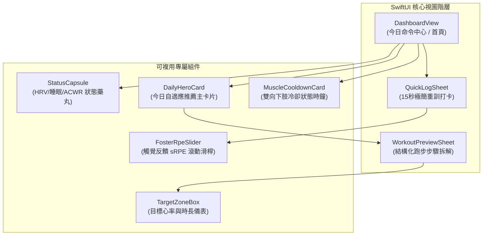

# iPhone 混合訓練自適應排課 App：第一版前端界面設計架構書 (UI/UX Spec)

> **版本**：v1.0  
> **相依標準**：`training_app_spec.md v1.2`、iOS 17+ Human Interface Guidelines (HIG)  
> **目標平台**：純 iPhone 直向體驗 (Portrait Only, iPhone 14/15/16 Pro 視口比例 393 × 852 pt)  
> **可互動原型**：[ui_prototype.html](file:///e:/Build/docs/ui_prototype.html)

---

## 一、 設計哲學與視覺調性 (Aesthetic & Style)

遵循 `/frontend-design` 原則，本產品定位為 **「Precision Athletic / 競技儀表」**：
1. **反對浮誇裝飾**：
   * 拒絕無意義的背景裝飾模糊漸層光暈或全黑無階層的粗糙設計。
   * 採用深石墨冷調（`#090C10` 底色搭 `#161B22` 表面），營造純粹、專注、專業的訓練儀表感。
2. **顏色即語義 (Color as Semantics)**：
   * **電光藍 (`#58A6FF`)**：代表心肺有氧與目標區間（Zone 1~5）。
   * **琥珀暖金 (`#E3B341`)**：代表局部肌群冷卻倒數與修復時鐘。
   * **生理就緒綠 (`#3FB950`)**：代表自律神經與睡眠狀態充沛。
   * **警示珊瑚紅 (`#F85149`)**：代表 ACWR 明顯超標或傷病中斷提示。
3. **單手操作優化 (Thumb Zone First)**：
   * 核心互動操作（如「15 秒重訓打卡」、「同步至 Apple Watch」）均配置於手機下半部拇指舒適區。

---

## 二、 三大核心畫面規格與 SwiftUI 組件劃分

---

## 三、 視圖細節與互動規格

### 1. 今日命令中心 (`DashboardView`)
* **頂部導航**：動態展示當前日期、星期與週排程進度（例如：`10月17日 星期六 · 本週 3/4 天`）。
* **生理與負荷狀態藥丸 (`StatusCapsule`)**：
  * 左側：展示當日自律神經狀態（例如：`● 恢復良好 (HRV Z: +0.4)`）。若無 HRV 則自動降級顯示睡眠時數，並呈現低信心灰色。
  * 右側：展示 7 天 ACWR 負荷比（例如：`● 7天 ACWR: 1.12 穩健`）。
* **今日自適應主卡片 (`DailyHeroCard`)**：
  * 首要展示由 `TrainingPolicyEngine` 仲裁出的當日推薦課表（例如：`🏃 Zone 2 基底慢跑 · 40分鐘`）。
  * 內嵌目標心率區間（例如：`130~144 bpm`）與預估負荷 AU。
  * 點擊直接以標準 iOS Sheet 展開 `WorkoutPreviewSheet`。
* **雙向下肢冷卻卡片 (`MuscleCooldownCard`)**：
  * 當腿部處於冷卻倒數中（例如前一日有深蹲或長跑），卡片顯示剩餘冷卻小時（`剩餘 20 小時`）。
  * 附帶啟發式提示文字：*「今日課表已自動限制為低衝擊有氧跑，避開高強度間歇與下肢衝擊。」*
* **底部固定動作條**：常駐綠色高對比 `+ 記錄重量訓練 (15 秒打卡)` 按鈕。

---

### 2. WorkoutKit 結構化課表預覽 (`WorkoutPreviewSheet`)
* **用途**：讓跑者在出門前清楚知道今天的訓練結構，並一鍵送上手錶。
* **內容呈現**：
  * 垂直步驟鏈：`1. 熱身 (5:00)` $\rightarrow$ `2. 主區間 (30:00, Zone 2)` $\rightarrow$ `3. 緩和 (5:00)`。
* **手錶同步按鈕**：
  * 呼叫 `WorkoutScheduler.shared.schedule(workoutPlan, at: dateComponents)`。
  * 觸發成功後產生 iOS 原生震動反饋（`UINotificationFeedbackGenerator.success`），提示課表已推播至 Apple Watch 原生體能訓練 App。

---

### 3. 15 秒極簡重訓打卡彈窗 (`QuickLogSheet`)
* **設計目標**：保證在 **15 秒、兩次點擊** 內完成打卡，徹底消除記錄阻力。
* **步驟拆解**：
  * **第 1 步：部位快速點選**：大尺寸膠囊按鈕，提供 `推 (Push)`、`拉 (Pull)`、`腿 (Legs)` 3 個單選/複選鈕。
  * **第 2 步：訓練時間確認**：預設帶入 45 分鐘，附帶 `− 5m` / `+ 5m` 快捷按鈕。
  * **第 3 步：Foster sRPE 滑桿**：範圍 1.0～10.0，即時連動顯示強度文字（如 `7.5 (吃力)`）與即時計算之肌力負荷（例如 `45m × 7.5 = 337 AU`）。
* **點擊儲存**：
  * 寫入本地 SwiftData 記錄，即時更新下肢腿部冷卻時鐘，並關閉彈窗。

---

## 四、 實體互動原型驗證

已為此規格建立單一獨立的 HTML/CSS/JS 互動原型，可於本機直接以瀏覽器開啟檢視與操作：
👉 **[ui_prototype.html](file:///e:/Build/docs/ui_prototype.html)**

### 可互動驗證項目：
1. **點擊「今日自適應課表主卡片」**：可展開 WorkoutKit 結構化步驟預覽與推播示意。
2. **點擊底部「記錄重量訓練」**：可展開 15 秒極簡打卡 Sheet，滑動 sRPE 滾動條觀察負荷 AU 動態計算。
3. **點擊受力部位 (推/拉/腿)**：觀察即時選取切換與冷卻關聯提示。
