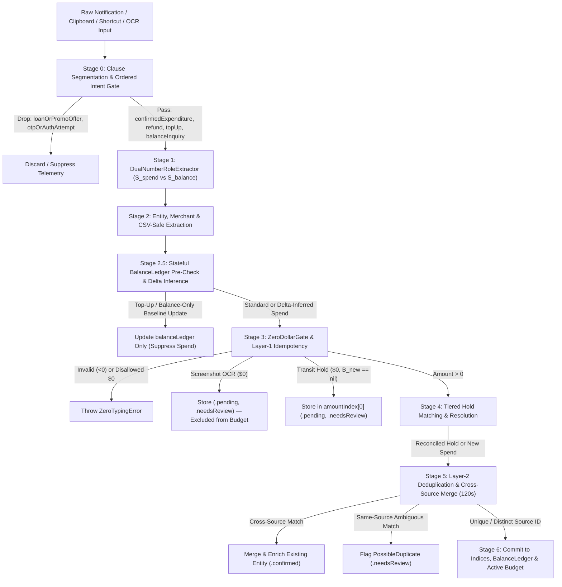

# ZeroTypingExpense: Comprehensive Algorithm & State Engine Specification
*Document Version: 2.2.0 (Production Commercial Standard — Formally Verified)*  
*Target Environment: iOS 18.1+ (iOS 26.0+ for FoundationModels `@Generable`, iOS 17.0+ Deterministic Fallback) / macOS 15.1+ / Swift 6.0 / Swift Testing*  
*Purpose: Standalone architectural, mathematical, and state-machine specification for external verification tools (Claude, ChatGPT o1/o3, formal analyzers, security scanners).*

---

## 1. System Pipeline Architecture

The ZeroTypingExpense engine processes financial telemetry across multiple iOS entry points (Apple Wallet Automation, Push Notification OCR, Screenshot OCR, Clipboard, URL Schemes, Apple Intelligence Shortcuts) using a deterministic 7-stage pipeline.



---

## 2. Mathematical Formalization & State Machines

### 2.1 Stage 0: Clause Segmentation & Ordered Intent Classification Gate

#### Pre-Normalization & Segmentation
Raw push notification text $T$ is pre-normalized against dot-matrix display artifacts by mapping letter `O`/`o` to digit `0` when adjacent to digits or a decimal point:
$$\text{normalize}(T): \text{regex replace } (?<=[\d.])[Oo](?=[\d.]|\b) \longrightarrow 0$$

The normalized string is split into discrete clauses $C = \{c_1, c_2, \dots, c_m\}$ using the boundary pattern (protecting decimals and merchant abbreviations):
$$\mathcal{P}_{\text{split}} = (?:[\n\text{。；};|] \mid (?<!\b(?:Co|Ltd|Inc|St|No|Dr))\.(\s+|$))$$

#### Deterministic Intent Assignment Function (Strict Precedence Order)
Each clause $c_k$ is evaluated against an ordered priority cascade to assign $\mathcal{I}(c_k) \in \text{NotificationIntent}$:
1. **`otpOrAuthAttempt`**: Matches verification markers (`驗證碼`, `一次性密碼`, `動態密碼`, `OTP`, `verification code`, `security code`).
2. **`topUpOrInternalTransfer`**: Matches reload indicators (`自動增值`, `已增值`, `增值服務`, `八達通增值`, `top up`, `top-up`, `reload`, `AAVS`). *(Evaluated before expenditure so AAVS credit-card deductions are never double-counted as expenses).*
3. **`refundOrReversal`**: Matches refund verbs (`已退款`, `退回`, `退款`, `沖正`, `撤銷`, `refund`, `refunded`, `reversed`).
4. **`loanOrPromoOffer`**: Matches loan/limit keywords (`貸款`, `借貸`, `預批`, `現金分期`, `月平息`, `實際年利率`, `信用額`, `最低還款`, `loan`, `pre-approved`, `installment`, `APR`, `credit limit`, `min pay`) OR conditional promo keywords (`高達`, `低至`, `消費滿`, `簽賬滿`, `回贈`, `獎賞`, `抽獎`, `優惠券`, `up to`, `as low as`, `cashback`, `rebate`, `coupon`) without an unconditioned settled-payment verb.
5. **`confirmedExpenditure`**: Matches settled-payment indicators (`已扣除`, `扣除`, `已付款`, `付款(?!日|到期)`, `消費(?!滿|回贈|獎賞|券)`, `支付`, `扣款`, `交易金額`, `deducted`, `paid`, `spent`, `charged`, `payment of`).
6. **`balanceInquiryOnly`**: Matches balance keywords (`餘額`, `結餘`, `剩餘儲值`, `remaining value`, `balance`) with no settled-payment indicator.

**Filtering Rule**: Clauses where $\mathcal{I}(c_k) \in \{\text{loanOrPromoOffer}, \text{otpOrAuthAttempt}\}$ are immediately dropped.

---

### 2.2 Stage 1: Role-Anchored Dual-Number Extraction (`DualNumberRoleExtractor`)

To prevent "Spent vs. Balance" collisions on single-line notifications (e.g., *"已從您的八達通扣除 HK$15.50，餘額為 HK$234.50"*):

#### Candidate Set & Bounded Prefix Windows
Given currency candidates $\mathcal{V} = \{v_1, v_2, \dots, v_n\}$ with character spans $[\text{start}(v_i), \text{end}(v_i))$, let $\text{bound}(v_i)$ be the index immediately following the closest preceding sub-clause delimiter in $\mathcal{D}_{\text{bound}} = \{\text{，}, \text{,}, \text{。}, \text{;}, \text{；}, \backslash\text{n}, \backslash\text{r}, \text{|}\}$:

$$\text{bound}(v_i) = \max\left(\{0\} \cup \{j + 1 \mid 0 \le j < \text{start}(v_i) \land c_k[j] \in \mathcal{D}_{\text{bound}}\}\right)$$
$$W(v_i) = c_k[\max(\text{start}(v_i) - 25, \text{bound}(v_i)) \dots \text{start}(v_i))$$

#### Dual Scoring Matrices (Longest Non-Overlapping Token Match)
Let $\mathcal{T}(W(v_i))$ be the set of longest non-overlapping lexicon matches inside $W(v_i)$:

$$S_{\text{spend}}(v_i) = \sum_{w \in \mathcal{T}(W(v_i))} \begin{cases}
+3 & \text{if } w \in \{\text{已扣除, 扣除, 扣款, 已付款, 付款, 消費, 支付, 交易金額, deducted, paid, spent, charged, payment of}\} \\
-5 & \text{if } w \in \{\text{餘額, 結餘, 剩餘, 可用, 儲值額, balance, remaining, bal, avail, 高達, 增值}\} \\
0 & \text{otherwise}
\end{cases}$$

$$S_{\text{balance}}(v_i) = \sum_{w \in \mathcal{T}(W(v_i))} \begin{cases}
+3 & \text{if } w \in \{\text{現時餘額, 最新結餘, 可用餘額, 可用信用額, 剩餘儲值, 餘額, 結餘, remaining value, remaining balance, balance, bal, avail}\} \\
-5 & \text{if } w \in \{\text{已扣除, 扣除, 消費, 已付款, 付款, deducted, paid, spent}\} \\
0 & \text{otherwise}
\end{cases}$$

#### Selection & Self-Correction Rule
1. $\hat{v}_{\text{spend}} = \arg\max_{v_i \in \mathcal{V}} S_{\text{spend}}(v_i)$ subject to $S_{\text{spend}}(\hat{v}_{\text{spend}}) > 0$ (else `nil`).
2. $\hat{v}_{\text{balance}} = \arg\max_{v_i \in \mathcal{V}} S_{\text{balance}}(v_i)$ subject to $S_{\text{balance}}(\hat{v}_{\text{balance}}) > 0$ (else `nil`).
3. **Self-Correction Guard**: If the on-device LLM selects $v_{\text{LLM}}$ such that:
   $$v_{\text{LLM}} == \hat{v}_{\text{balance}} \land S_{\text{balance}}(\hat{v}_{\text{balance}}) > S_{\text{spend}}(\hat{v}_{\text{balance}})$$
   the engine deterministically overrides $v_{\text{LLM}}$ with $\hat{v}_{\text{spend}}$.

---

### 2.3 Stage 2.5: Stateful BalanceLedger Engine (Pre-Ingestion Inference & Baseline Guard)

Maintains actor-isolated stored-value card states:
```swift
struct BalanceSnapshot: Codable, Sendable {
    let balanceMinor: Int64
    let updatedAt: Date
}
// Keyed by "provider:accountAlias" (e.g. "octopus:default")
var balanceLedger: [String: BalanceSnapshot]
```

Let $B_{\text{prev}} = \text{balanceLedger}[k]?.balanceMinor$, $B_{\text{new}} = T.\text{remainingBalanceMinor}$, and $S = T.\text{amountMinor}$. Transitions are evaluated in strict order:

- **Guard 0: Negative Buffer & Ceiling Anomaly Guard** (Octopus bounds $[-5000, 300000]$ minor units, i.e., $-\text{HK}\$50.00$ to $\text{HK}\$3,000.00$):
  $$\text{If } B_{\text{new}} \neq \text{nil} \land (B_{\text{new}} < -5000 \lor B_{\text{new}} > 300000 \lor (B_{\text{prev}} \neq \text{nil} \land S > 0 \land B_{\text{prev}} - S < -5000)):$$
  Reject delta inference, retain $S$, and flag `reviewStatus = .needsReview` (desynchronization alert).
- **State 0: Cold-Start Initialization** ($B_{\text{prev}} == \text{nil} \land B_{\text{new}} \neq \text{nil}$):
  Initialize $\text{balanceLedger}[k] \leftarrow (B_{\text{new}}, t)$. If $\mathcal{I} \in \{\text{topUpOrInternalTransfer}, \text{balanceInquiryOnly}\}$, terminate without creating an expense.
- **State 1: Silent Top-Up / AAVS Detection** ($\mathcal{I} == \text{topUpOrInternalTransfer} \lor (B_{\text{new}} \neq \text{nil} \land B_{\text{new}} > B_{\text{prev}})$):
  Update baseline: $\text{balanceLedger}[k] \leftarrow (B_{\text{new}}, t)$.
  Suppress negative spending; terminate expenditure pipeline (`type = .topUp`).
- **State 2: Dual Match Verification** ($S > 0 \land B_{\text{new}} \neq \text{nil} \land B_{\text{prev}} \neq \text{nil}$):
  $$\text{If } B_{\text{prev}} - S == B_{\text{new}} \implies \text{Ledger Confidence } = 1.0$$
  Update $\text{balanceLedger}[k] \leftarrow (B_{\text{new}}, t)$ and proceed to Stage 3.
- **State 3: Inferred Spent Recovery** ($S == 0 \land B_{\text{new}} \neq \text{nil} \land B_{\text{prev}} \neq \text{nil} \land B_{\text{new}} < B_{\text{prev}}$):
  $$\Delta = B_{\text{prev}} - B_{\text{new}}$$
  $$\text{If } 0 < \Delta \le 300,000:$$
  Promote inferred spend before Stage 3:
  $$T.\text{amountMinor} \leftarrow \Delta, \quad \mathcal{I} \leftarrow \text{.confirmedExpenditure}$$
  Set $T.\text{reviewStatus} \leftarrow \text{.needsReview}$ (upgraded to `.confirmed` in Stage 4 if it reconciles an active hold within $300\text{s}$).
  Update $\text{balanceLedger}[k] \leftarrow (B_{\text{new}}, t)$ and proceed to Stage 3.

---

### 2.4 Stage 3: ZeroDollarGate & Layer-1 Idempotency

#### ZeroDollarGate Formal Rule
Let incoming transaction after Stage 2.5 be $T = (a, p, \text{source}, B_{\text{new}})$:

$$\text{ZeroDollarGate}(T) = \begin{cases}
\text{REJECT (invalidAmount)} & \text{if } a < 0 \\
\text{PASS (Hold Candidate)} & \text{if } a == 0 \land B_{\text{new}} == \text{nil} \land (p == \text{.octopus} \lor T.\text{isTransitPreAuth}) \\
\text{PASS (Unresolved OCR)} & \text{if } a == 0 \land \text{source} == \text{.screenshotOCR} \implies (\text{.pending}, \text{.needsReview}) \\
\text{REJECT (zeroAmountNotAllowed)} & \text{if } a == 0 \land \text{source} \neq \text{.screenshotOCR} \land \neg(p == \text{.octopus} \lor T.\text{isTransitPreAuth}) \\
\text{PASS (Standard Spend)} & \text{if } a > 0
\end{cases}$$

- **Hold Candidate ($a == 0$)**: Stored in `transactions`, `idempotencyIndex`, and `amountIndex[0]` with `paymentStatus = .pending` and `reviewStatus = .needsReview`.
- **Unresolved OCR ($a == 0$)**: Stored in `transactions` with `paymentStatus = .pending` and `reviewStatus = .needsReview` (excluded from `amountIndex[0]` transit hold matching and excluded from active budget).

#### Layer-1 Event-Level Idempotency
$$\text{Key} = \text{SHA256}(T.\text{idempotencyKey})$$
If `idempotencyIndex[Key]` exists, return existing `TransactionEntity` with zero state mutations.

---

### 2.5 Stage 4: Tiered Transit Hold Matching Engine

Active holds reside in `amountIndex[0]`. When a positive expenditure $T_{\text{new}}$ ($a > 0$) arrives:

$$\mathcal{W}_{\text{hold}}(T_{\text{new}}) = \begin{cases}
900\text{ seconds (15 min)} & \text{if } T_{\text{new}}.\text{provider} == \text{.octopus} \lor T_{\text{new}}.\text{isTransit} \\
86400\text{ seconds (24 hours)} & \text{if } T_{\text{new}}.\text{provider} \in \{\text{.applePay}, \text{.creditCard}\}
\end{cases}$$

#### Reconciliation Conditions & Tie-Breaking
1. **Provider & Time Window**: $T_{\text{hold}}.\text{provider} == T_{\text{new}}.\text{provider}$ (or Apple Pay $\leftrightarrow$ Octopus bridge) and $|t(T_{\text{new}}) - t(T_{\text{hold}})| \le \mathcal{W}_{\text{hold}}(T_{\text{new}})$. *(Cross-device Apple Watch $\leftrightarrow$ iPhone matches are permitted).*
2. **Merchant Compatibility**:
   $$\text{Compatible}(M_{\text{hold}}, M_{\text{new}}) = M_{\text{hold}} \in \mathcal{G}_{\text{generic}} \lor M_{\text{new}} \in \mathcal{G}_{\text{generic}} \lor M_{\text{hold}} \approx M_{\text{new}}$$
   where placeholder set $\mathcal{G}_{\text{generic}} = \{\text{"", "octopus", "八達通", "apple pay", "transit", "交通", "unknown", "未知商戶"}\}$. *(Specific transit operators such as "mtr", "港鐵", "九巴", "kmb" are canonical merchants, NOT generic placeholders).*
3. **Closest-Time Selection & State Mutation**:
   Select $T_{\text{hold}}^* = \arg\min_{T_{\text{hold}}} |t(T_{\text{new}}) - t(T_{\text{hold}})|$:
   - $T_{\text{hold}}^*.\text{amountMinor} \leftarrow T_{\text{new}}.\text{amountMinor}$.
   - If $M_{\text{hold}} \in \mathcal{G}_{\text{generic}} \land M_{\text{new}} \notin \mathcal{G}_{\text{generic}}$, upgrade $T_{\text{hold}}^*.\text{merchant} \leftarrow M_{\text{new}}$.
   - $T_{\text{hold}}^*.\text{paymentStatus} \leftarrow \text{.completed}$, $T_{\text{hold}}^*.\text{reviewStatus} \leftarrow \text{.confirmed}$.
   - Remove $T_{\text{hold}}^*$ from `amountIndex[0]` and insert into $\text{amountIndex}[T_{\text{new}}.\text{amountMinor}]$.

---

### 2.6 Stage 5: Layer-2 Deduplication & Cross-Source Merge ($\Delta t \le 120\text{s}$)

For an incoming or newly-reconciled transaction $T$ ($a > 0$), query candidates $C \in \text{amountIndex}[T.a]$ where $|t(T) - t(C)| \le 120\text{s}$, $C.\text{currency} == T.\text{currency}$, and $\text{Compatible}(C.\text{merchant}, T.\text{merchant})$:

- **Cross-Source Enrichment** ($C.\text{ingestionSource} \neq T.\text{ingestionSource}$):
  Occurs when Apple Wallet Shortcut ($t_0$) and Bank Push OCR ($t_0 + 5\text{s}$) capture the same purchase.
  - If $C.\text{sourceTransactionId} \neq \text{nil} \land T.\text{sourceTransactionId} \neq \text{nil} \land C.\text{sourceTransactionId} \neq T.\text{sourceTransactionId}$: treat as **Distinct Purchases** (store both).
  - Otherwise: Merge into existing entity $C$ (`merged.id == C.id`), enriching `sourceTransactionId`, `remainingBalanceMinor`, and upgrading generic merchant names. Retain `reviewStatus = .confirmed` and `duplicateStatus = .unique`.
- **Same-Source Collision** ($C.\text{ingestionSource} == T.\text{ingestionSource}$):
  - **Case 2a (Distinct Provider IDs)**:
    $$\text{If } C.\text{sourceTransactionId} \neq \text{nil} \land T.\text{sourceTransactionId} \neq \text{nil} \land C.\text{sourceTransactionId} \neq T.\text{sourceTransactionId} \implies \text{Distinct Purchases (Store } T \text{ as .confirmed)}$$
  - **Case 2b (Identical Provider ID)**:
    $$\text{If } C.\text{sourceTransactionId} \neq \text{nil} \land C.\text{sourceTransactionId} == T.\text{sourceTransactionId} \implies \text{Idempotent Replay (Return } C\text{)}$$
  - **Case 2c (Missing Provider ID on Either Side)**:
    Store $T$, link $(C.\text{id} \leftrightarrow T.\text{id})$ in `pairedDuplicates`, mark both `duplicateStatus = .possibleDuplicate`, and downgrade to `reviewStatus = .needsReview`.

---

### 2.7 Stage 6: Active Budget Recalculation & Ledger Isolation

Active monthly budget consumption $C_{\text{month}}$ is calculated across transactions $T \in \mathcal{T}_{\text{month}}$:

$$C_{\text{month}} = \sum_{T \in \mathcal{T}_{\text{month}}} \phi(T) \cdot T.\text{amountMinor}$$

$$\phi(T) = \begin{cases}
+1 & \text{if } T.\text{type} == \text{.expense} \land T.\text{paymentStatus} == \text{.completed} \land T.\text{reviewStatus} == \text{.confirmed} \land \neg T.\text{isHidden} \\
-1 & \text{if } T.\text{type} == \text{.refund} \land T.\text{paymentStatus} == \text{.completed} \land T.\text{reviewStatus} == \text{.confirmed} \land \neg T.\text{isHidden} \\
0 & \text{if } T.\text{type} \in \{\text{.transfer}, \text{.topUp}, \text{.income}, \text{.unknown}\} \lor T.\text{paymentStatus} == \text{.pending} \lor T.\text{reviewStatus} == \text{.needsReview} \lor T.\text{isHidden}
\end{cases}$$

---

## 3. Concrete Test Assertions (Verification Matrix)

| Test ID | Input Scenario / Telemetry | Expected Output & Invariant Bounds |
| :--- | :--- | :--- |
| **ATM-01** | Rapid consecutive transactions ($t_1, t_1 + 2\text{s}$) from same source with identical amounts but distinct non-nil `sourceTransactionId` | Matches Stage 5 Case 2a (!=); preserved as 2 distinct `.confirmed` transactions; zero duplicate review. |
| **ATM-02** | Transaction with negative amount (`amountMinor: -500`) | Throws `ZeroTypingError.invalidAmount`; hard rejection at Stage 3. |
| **ATM-08** | Screenshot OCR with missing amount (`amountMinor: 0`) and non-transit provider | Passes Stage 3 Unresolved OCR branch; stored as `(.pending, .needsReview)`; $\phi(T) = 0$ (excluded from budget). |
| **ATM-11** | CSV injection prefix (`=SUM(A1:A10)`, `+cmd`, `@eval`) in merchant or notes | Prepend `'` sanitization (`'=SUM(A1:A10)`); zero formula execution. |
| **ATM-19** | Zero amount (`0.00`) submitted via URL scheme or standard non-transit shortcut | Throws `ZeroTypingError.zeroAmountNotAllowed`; hard rejection at Stage 3. |
| **STG-01** | *"立即申請現金分期高達 HK$500,000！"* | Stage 0 Intent: `loanOrPromoOffer`; dropped before extraction (`nil`). |
| **STG-02** | *"已從您的八達通扣除 HK$15.50，餘額為 HK$234.50。"* | Stage 1 Spent: 1550 ($S_{\text{spend}} = +3$), Balance: 23450 ($S_{\text{balance}} = +3$), Intent: `confirmedExpenditure`. |
| **STG-03** | Octopus balance drops from HK$234.50 to HK$212.50 following a $\$0$ tap | Stage 2.5 State 3 infers 2200 minor units (HK$22.00); Stage 4 reconciles $\$0$ hold in `amountIndex[0]`; baseline updated to 21250. |
| **STG-04** | Octopus AAVS auto-reload from HK$12.50 to HK$512.50 | Stage 2.5 State 1 updates `balanceLedger` baseline to 51250; terminates with `type = .topUp` ($\phi(T) = 0$). |
| **STG-05** | Wallet shortcut + Bank push OCR arrive 5s apart | Stage 5 Cross-Source Merge enriches first entity (`merged.id == first.id`, `reviewStatus == .confirmed`). |
